# Deep Charter feature map

<!-- Generated by tools/feature_map.py from docs/feature-map/map.json. Do not edit; edit the map and regenerate. -->

Everything in the game on one page: the mechanics, the upgrade ladders, the hazards and what counters them, the goals, the resources and where they flow, the creatures and the terminals. Built features sit beside what is planned, so this page shows what exists and what comes next. The same map, with pan, zoom and filters, is the [interactive view](https://pkeppeler.github.io/deepcharter/).

How it is kept current: [the feature-map skill](../.claude/skills/feature-map/SKILL.md). The source is [map.json](feature-map/map.json).

## Legend

| Look | Meaning |
|---|---|
| Solid green | Built: it is in the game today |
| Solid amber | In progress: an open pull request builds it |
| Solid grey | Planned: an open issue or a settled decision, not started |
| Dashed grey | Idea: in the spec or the notes, not decided |
| Plain dashed outline | A feature of another ladder that this one points at |

Arrows: a plain arrow means "comes before" (needed for, leads to). A dashed arrow marked *counters* goes from a counter to the hazard it answers. A thick arrow marked *feeds* is a flow of ore, money, fuel or spoil. ⚙️ mechanic. ⬆️ upgrade. ☠️ hazard. 🛡️ counter. 🎯 goal. 💎 resource. 🖥️ terminal. 🧪 consumable. 👁️ creature. 📍 place.

## The core loop

Dig down, haul ore home, sell it, buy a better pod, go deeper. Fuel is the clock and the deep hits back. This is the first pillar, the upgrade loop.

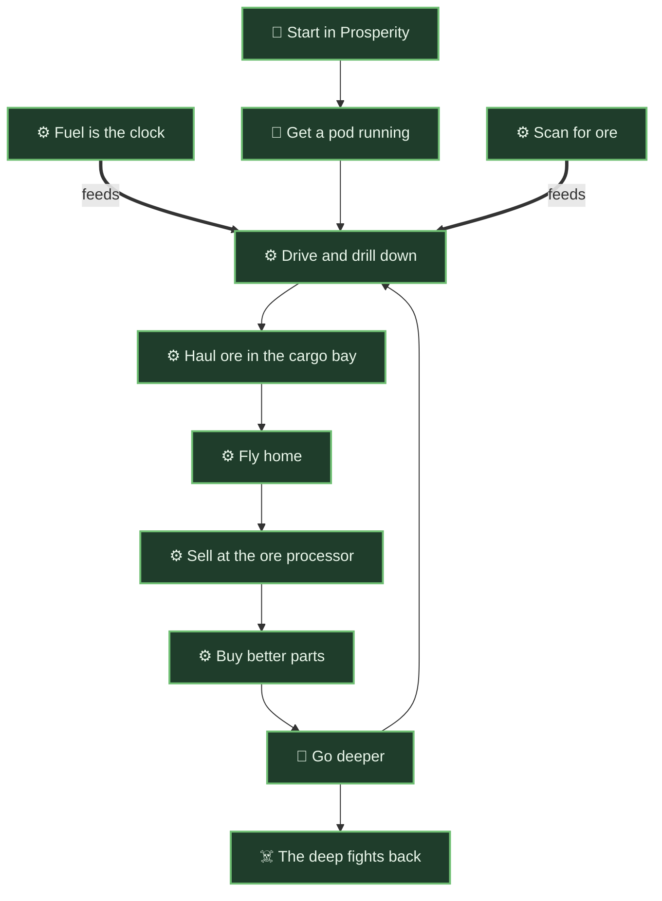

| Icon | Still | Feature | What it is | Status | Links |
|---|---|---|---|---|---|
| 📍 | <a href="https://github.com/pkeppeler/deepcharter/blob/pr-media/readme/colony-square.png?raw=true"></a> | <a id="start-in-prosperity"></a>**Start in Prosperity**<br>place | You spawn in a run-down Company mining town on a bare red plain, with a dead pod in the hangar. | ✅ Built | [SPEC.md](SPEC.md#surface-and-colony) |
| 🎯 | <a href="https://github.com/pkeppeler/deepcharter/blob/pr-media/readme/colony-hangar.png?raw=true"></a> | <a id="gear-up"></a>**Get a pod running**<br>goal | Gather salvage, repair the terminals and the founding Mole. | ✅ Built | [SPEC.md](SPEC.md#bootstrap) |
|  | <a href="https://github.com/pkeppeler/deepcharter/blob/pr-media/readme/drilling.gif?raw=true"></a> | <a id="dig-down"></a>**Drive and drill down**<br>mechanic | Treads on the ground, a rotor to fly, a drill that bores down and sideways, never up. | ✅ Built | [SPEC.md](SPEC.md#movement), [ADR 0004](adr/0004-pods-are-vehicles.md) |
|  | <a href="https://github.com/pkeppeler/deepcharter/blob/pr-media/looks/a-dusk-company/hud-pod-status-and-altimeter-surface.jpg?raw=true"></a> | <a id="fuel-clock"></a>**Fuel is the clock**<br>mechanic | Fuel drains all the time and faster when drilling; running dry strands the pod. | ✅ Built | [SPEC.md](SPEC.md#fuel-and-stranded) |
|  | <a href="https://github.com/pkeppeler/deepcharter/blob/pr-media/readme/scanner-map.png?raw=true"></a> | <a id="scan-ahead"></a>**Scan for ore**<br>mechanic | The scanner is a side-view map of the rock around the pod, ore as bright dots. | ✅ Built | [SPEC.md](SPEC.md#scanner) |
|  | <a href="https://github.com/pkeppeler/deepcharter/blob/pr-media/readme/ore-cargo.png?raw=true"></a> | <a id="haul-ore"></a>**Haul ore in the cargo bay**<br>mechanic | Ore is heavy and non-stacking; a full bay cuts the lift. | ✅ Built | [ADR 0008](adr/0008-ore-is-an-item-with-a-mass.md) |
| ⚙️ | <a href="https://github.com/pkeppeler/deepcharter/blob/pr-media/readme/pod-flying.png?raw=true"></a> | <a id="fly-home"></a>**Fly home**<br>mechanic | Drive or fly back up the shaft before the fuel runs out. | ✅ Built |  |
| 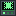 | <a href="https://github.com/pkeppeler/deepcharter/blob/pr-media/looks/a-dusk-company/screen-ore-processor-online.jpg?raw=true"></a> | <a id="sell-at-processor"></a>**Sell at the ore processor**<br>mechanic | Park by the processor; the ore pays into the charter's account. | ✅ Built |  |
|  | <a href="https://github.com/pkeppeler/deepcharter/blob/pr-media/readme/upgrade-terminal.png?raw=true"></a> | <a id="buy-parts-loop"></a>**Buy better parts**<br>mechanic | Money buys tiered pod parts at the upgrade terminal. | ✅ Built |  |
| 🎯 | <a href="https://github.com/pkeppeler/deepcharter/blob/pr-media/looks/a-dusk-company/layer-2-cave-north.jpg?raw=true"></a> | <a id="go-deeper"></a>**Go deeper**<br>goal | A stronger pod bores through the breach into the next layer, where the ore pays more and the hazards bite harder. | ✅ Built |  |
| ☠️ | <a href="https://github.com/pkeppeler/deepcharter/blob/pr-media/readme/pod-lava.gif?raw=true"></a> | <a id="the-deep-bites"></a>**The deep fights back**<br>hazard | Lava, gas, Company Rock, the crust, darkness and the Retained, each with a ladder of counters. | ✅ Built |  |

## How the ladders connect

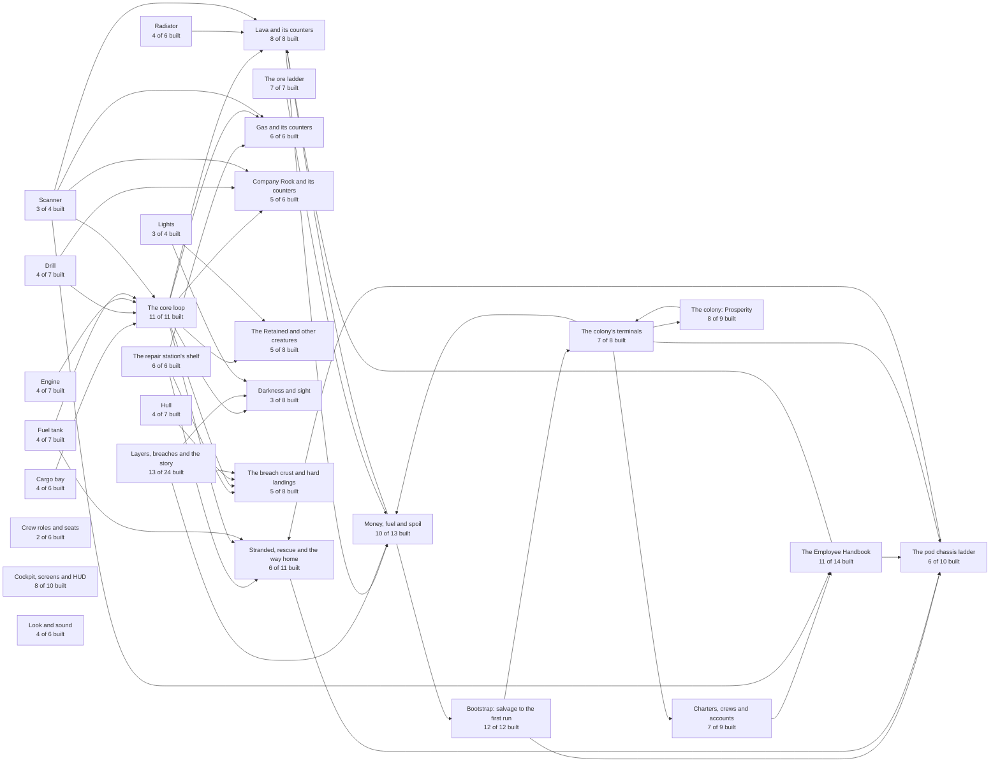

## Status at a glance

| Ladder | Built | In progress | Planned | Idea |
|---|---|---|---|---|
| [The core loop](#the-core-loop) | 11 | 0 | 0 | 0 |
| [Money, fuel and spoil](#money-fuel-and-spoil) | 10 | 0 | 1 | 2 |
| [The ore ladder](#the-ore-ladder) | 7 | 0 | 0 | 0 |
| [Bootstrap: salvage to the first run](#bootstrap-salvage-to-the-first-run) | 12 | 0 | 0 | 0 |
| [The colony's terminals](#the-colonys-terminals) | 7 | 0 | 1 | 0 |
| [The Employee Handbook](#the-employee-handbook) | 11 | 0 | 3 | 0 |
| [Layers, breaches and the story](#layers-breaches-and-the-story) | 13 | 1 | 9 | 1 |
| [Charters, crews and accounts](#charters-crews-and-accounts) | 7 | 0 | 1 | 1 |
| [The colony: Prosperity](#the-colony-prosperity) | 8 | 0 | 0 | 1 |
| [The pod chassis ladder](#the-pod-chassis-ladder) | 6 | 0 | 4 | 0 |
| [Drill](#drill) | 4 | 0 | 3 | 0 |
| [Hull](#hull) | 4 | 0 | 3 | 0 |
| [Engine](#engine) | 4 | 0 | 3 | 0 |
| [Fuel tank](#fuel-tank) | 4 | 0 | 3 | 0 |
| [Radiator](#radiator) | 4 | 0 | 2 | 0 |
| [Cargo bay](#cargo-bay) | 4 | 0 | 2 | 0 |
| [Scanner](#scanner) | 3 | 0 | 1 | 0 |
| [Lights](#lights) | 3 | 0 | 1 | 0 |
| [Lava and its counters](#lava-and-its-counters) | 8 | 0 | 0 | 0 |
| [Gas and its counters](#gas-and-its-counters) | 6 | 0 | 0 | 0 |
| [Company Rock and its counters](#company-rock-and-its-counters) | 5 | 1 | 0 | 0 |
| [The Retained and other creatures](#the-retained-and-other-creatures) | 5 | 0 | 1 | 2 |
| [Darkness and sight](#darkness-and-sight) | 3 | 0 | 4 | 1 |
| [The breach crust and hard landings](#the-breach-crust-and-hard-landings) | 5 | 0 | 1 | 2 |
| [Stranded, rescue and the way home](#stranded-rescue-and-the-way-home) | 6 | 0 | 4 | 1 |
| [The repair station's shelf](#the-repair-stations-shelf) | 6 | 0 | 0 | 0 |
| [Crew roles and seats](#crew-roles-and-seats) | 2 | 0 | 0 | 4 |
| [Cockpit, screens and HUD](#cockpit-screens-and-hud) | 8 | 1 | 1 | 0 |
| [Look and sound](#look-and-sound) | 4 | 0 | 1 | 1 |

## What is coming

### In progress

- **Company Rock look** (company-rock): A concept round for how Company Rock looks is under way; the chosen look is built later. [#503](https://github.com/pkeppeler/deepcharter/issues/503), [company-rock-concepts.md](design/company-rock-concepts.md)
- **Cockpit HUD with gauges** (interface): A cockpit HUD with gauges that hides the vanilla hotbar while seated. [#247](https://github.com/pkeppeler/deepcharter/issues/247), [#520](https://github.com/pkeppeler/deepcharter/issues/520)
- **Layer rock textures and grades** (layers): Grained rock textures for layers 1 and 2, a lava redraw and an I-beam fix; depth palettes and colour grades follow. [#241](https://github.com/pkeppeler/deepcharter/issues/241)

### Planned

- **Lighting art** (art): Glow accents and beams; see Darkness and sight. [#248](https://github.com/pkeppeler/deepcharter/issues/248)
- **Cargo bay tier 4** (cargo-bay): 70 ore slots, $5,000. No chassis built yet can fit it (a Badger or later). [SPEC.md](SPEC.md#components)
- **Cargo bay tier 5** (cargo-bay): 120 ore slots, $25,000. No chassis built yet can fit it (a Badger or later). [SPEC.md](SPEC.md#components)
- **Outposts and pads shared** (charter): A toggle to share a charter's outposts and pads with other charters. [SPEC.md](SPEC.md#6-charters)
- **Creatures and combat session** (creatures): A session with the user on rare unsettling creatures per layer and bosses; pod combat uses mining gear first. [#13](https://github.com/pkeppeler/deepcharter/issues/13), [SPEC.md](SPEC.md#13-creatures-and-combat)
- **Heat, pressure and flooding** (crust): Later layers add heat (the Magma Belt), pressure and flooding (the Drowned Deep) that the hull and radiator must answer. [SPEC.md](SPEC.md#story-layers)
- **Smooth moving light** (darkness): Glow accents, beams, an optional dynamic-lights mod and an opt-in shader pack. [#248](https://github.com/pkeppeler/deepcharter/issues/248)
- **HUD signal decay** (darkness): Near the bottom of a layer the readouts flicker, jump and finally drop out; the deeper, the more often. [#502](https://github.com/pkeppeler/deepcharter/issues/502)
- **Console upgrade** (darkness): A cockpit track whose tiers push the decay deeper; the top tier is immune. [#502](https://github.com/pkeppeler/deepcharter/issues/502)
- **Per-layer drones and the Lamp Hymn** (darkness): Each layer gets its own sound drone, with a hymn motif. [#249](https://github.com/pkeppeler/deepcharter/issues/249)
- **Drill tier 4** (drill): Drill speed 3.5x stock, $5,000. No chassis built yet can fit it (a Badger or later). [SPEC.md](SPEC.md#components)
- **Drill tier 5** (drill): Drill speed 4.75x stock, $25,000. No chassis built yet can fit it (a Badger or later). [SPEC.md](SPEC.md#components)
- **Drill tier 6** (drill): Drill speed 6.0x stock, $125,000. No chassis built yet can fit it (a Badger or later). [SPEC.md](SPEC.md#components)
- **Catalysts** (economy): Every chassis and every couple of tiers also needs a rare material from one layer; Cicatrium is the first. [SPEC.md](SPEC.md#economy)
- **Engine tier 4** (engine): Engine 1.27x stock, $5,000. No chassis built yet can fit it (a Badger or later). [SPEC.md](SPEC.md#components)
- **Engine tier 5** (engine): Engine 1.33x stock, $25,000. No chassis built yet can fit it (a Badger or later). [SPEC.md](SPEC.md#components)
- **Engine tier 6** (engine): Engine 1.4x stock, $125,000. No chassis built yet can fit it (a Badger or later). [SPEC.md](SPEC.md#components)
- **Fuel tank tier 4** (fuel-tank): Tank 6.0x stock, $5,000. No chassis built yet can fit it (a Badger or later). [SPEC.md](SPEC.md#components)
- **Fuel tank tier 5** (fuel-tank): Tank 10.0x stock, $25,000. No chassis built yet can fit it (a Badger or later). [SPEC.md](SPEC.md#components)
- **Fuel tank tier 6** (fuel-tank): Tank 15.0x stock, $125,000. No chassis built yet can fit it (a Badger or later). [SPEC.md](SPEC.md#components)
- **Wrecked prefabs that drop salvage** (getting-out): Ruined buildings and vehicles in the world that give scrap when broken. [#471](https://github.com/pkeppeler/deepcharter/issues/471)
- **Outposts at depth** (getting-out): Built shelters with fuel and sell terminals, beds and storage; the first goes at the layer 1 floor. [#320](https://github.com/pkeppeler/deepcharter/issues/320), [SPEC.md](SPEC.md#outposts-and-ratings)
- **Environment ratings** (getting-out): Each depth rates heat, pressure, flooding and quakes; an outpost under the rating is uninhabitable but never destroyed. [SPEC.md](SPEC.md#outposts-and-ratings)
- **Teleport pads** (getting-out): Paired pads a charter builds, at a power cost that grows with depth and mass; nothing mined teleports. [SPEC.md](SPEC.md#pads)
- **Hazards on higher scanners** (handbook): A handbook line about unseen hazards that a thermal tier shows; its wording is a user pick. [#306](https://github.com/pkeppeler/deepcharter/issues/306)
- **Revisions** (handbook): The handbook is revised five times as the story turns; tone changes, rules never do. [handbook.md](lore/handbook.md)
- **Spec sheets and first-exposure warnings** (handbook): After layer 2, each new rule is explained when you first meet it, not by a chapter. [SPEC.md](SPEC.md#the-world-is-a-mystery-the-rules-never-are)
- **Hull tier 4** (hull): Hull 8.0x stock, $5,000. No chassis built yet can fit it (a Badger or later). [SPEC.md](SPEC.md#components)
- **Hull tier 5** (hull): Hull 12.0x stock, $25,000. No chassis built yet can fit it (a Badger or later). [SPEC.md](SPEC.md#components)
- **Hull tier 6** (hull): Hull 18.0x stock, $125,000. No chassis built yet can fit it (a Badger or later). [SPEC.md](SPEC.md#components)
- **Front camera** (interface): A part that turns the cab window into a video feed, clear to the edges, that lava can cook and static can cut. [#448](https://github.com/pkeppeler/deepcharter/issues/448), [mechanics.md](design/mechanics.md#front-camera-448-a)
- **Breach crossing with no teleport** (layers): Crossing a breach inside the campaign world is a pure dig, with a rumble and a transmission. [#215](https://github.com/pkeppeler/deepcharter/issues/215)
- **One tall campaign world** (layers): The surface and story layers share one dimension, each a Y band with its own light and fog. [#214](https://github.com/pkeppeler/deepcharter/issues/214), [ADR 0029](adr/0029-the-campaign-is-one-tall-world-and-the-uncharted-chain-joins-through-seams.md)
- **Layer 3: Fungal Hollows** (layers): Huge fungal caverns lit by their own glow, spore gas, the first real on-foot exploring. [#214](https://github.com/pkeppeler/deepcharter/issues/214), [#504](https://github.com/pkeppeler/deepcharter/issues/504), [SPEC.md](SPEC.md#story-layers)
- **Layer 4: The Drowned Deep** (layers): Flooded caverns and pressure; the pod needs seals. The lost miners' story plays out. [SPEC.md](SPEC.md#story-layers)
- **Layers 5 to 8** (layers): The Lattice, the Magma Belt, the Ossuary and the Furnace, ending at Head Office. [SPEC.md](SPEC.md#story-layers), [LORE.md](LORE.md)
- **The finale: a choice** (layers): The boss breaks but cannot die; renounce the Controlling Interest to win, or sign and become the Chairman. [ADR 0031](adr/0031-the-finale-is-won-by-renunciation.md), [SPEC.md](SPEC.md#14-story-and-transmissions)
- **The Ramp** (layers): A few hundred blocks where drilling gets exponentially harder; the end of the campaign is obvious. [SPEC.md](SPEC.md#ramp)
- **Seams and the grained crust** (layers): A fast background swap hidden in a vertical-grained crust, with decoys that look the same. [#216](https://github.com/pkeppeler/deepcharter/issues/216), [#217](https://github.com/pkeppeler/deepcharter/issues/217), [SPEC.md](SPEC.md#seams-and-grained-crust)
- **Story-layer splicing** (layers): An update adds a new story layer at the seam without touching what is built ('the depths moved'). [#218](https://github.com/pkeppeler/deepcharter/issues/218), [SPEC.md](SPEC.md#splice-rule)
- **Lights tier 4** (lights): Light level 15, $3,750. No chassis built yet can fit it (a Badger or later). [SPEC.md](SPEC.md#components)
- **Badger** (pods): A wreck from layer 3 or 4: 2 to 3 seats, adds the operator, leans to the drill. [SPEC.md](SPEC.md#chassis)
- **Hauler** (pods): A wreck from layer 4 or 5: 3 seats, leans to cargo. Later the tender pod. [SPEC.md](SPEC.md#chassis)
- **Crawler** (pods): A wreck from layer 6: 3 to 4 seats, leans to armour against heat and pressure. [SPEC.md](SPEC.md#chassis)
- **Behemoth** (pods): A wreck from layer 7: 4 to 6 seats and an anchor mode. [SPEC.md](SPEC.md#chassis)
- **Radiator tier 4** (radiator): Lava costs 40 percent of stock, $25,000. No chassis built yet can fit it (a Badger or later). [SPEC.md](SPEC.md#components)
- **Radiator tier 5** (radiator): Lava costs 20 percent of stock, $125,000. No chassis built yet can fit it (a Badger or later). [SPEC.md](SPEC.md#components)
- **Scanner tier 4** (scanner): The widest, clearest map. $5,000. No chassis built yet can fit it (a Badger or later). [SPEC.md](SPEC.md#components)
- **Outpost terminals** (terminals): Fuel and sell terminals built at depth, selling at worse rates than the colony. [#320](https://github.com/pkeppeler/deepcharter/issues/320), [SPEC.md](SPEC.md#outposts-and-ratings)

### Idea

- **A public release** (art): A name, a licence and a soundtrack the project may publish; Modrinth, with its AI-content disclosure. [SPEC.md](SPEC.md#18-open-questions)
- **Competition between charters** (charter): A later update might add rivalry; today charters are friendly. [SPEC.md](SPEC.md#18-open-questions)
- **Anchor mode and outposts** (colony): A Behemoth that unfolds into a temporary outpost; built outposts with beds and storage. [SPEC.md](SPEC.md#outposts-and-ratings)
- **Layer bosses** (creatures): Bosses that mix pod fights and on-foot fights, by layer. [SPEC.md](SPEC.md#13-creatures-and-combat)
- **The Chairman** (creatures): The two-phase finale boss, broken but never killed. [ADR 0031](adr/0031-the-finale-is-won-by-renunciation.md)
- **Navigator** (crew): The eyes: active sonar, pings that cost power, echoes that must be read, targets marked on the pilot's HUD. [SPEC.md](SPEC.md#8-crew-roles-and-co-op-between-pods)
- **Operator** (crew): The hands: a manipulator arm and a charge launcher; a turret later. [SPEC.md](SPEC.md#8-crew-roles-and-co-op-between-pods)
- **Robots fill empty seats** (crew): A component that fills the navigator or operator seat with less skill. [SPEC.md](SPEC.md#8-crew-roles-and-co-op-between-pods)
- **Tender runs and spotting** (crew): One pod brings fuel and empty bays to a pod that keeps drilling; a second pod scans ahead. [SPEC.md](SPEC.md#co-op-between-pods)
- **Earthquakes and cave-ins** (crust): In certain layers a quake or cave-in blocks a stretch of shaft, small or large; it never deletes built blocks. [SPEC.md](SPEC.md#10-hazards)
- **Clearing a blockage** (crust): Explosives on foot, a pod charge launcher, crewmates from above, or an emergency teleport. [SPEC.md](SPEC.md#10-hazards)
- **The suit lamp** (darkness): On foot, a suit lamp on a battery; the finale's Unnumbered Lamp never runs out. [SPEC.md](SPEC.md#9-on-foot)
- **Records board** (economy): One entry per charter at the colony: deepest breach, wealth hauled, wrecks salvaged. [SPEC.md](SPEC.md#economy)
- **Registration fees grow** (economy): Each extra pod a charter registers costs more, so a free second Mole is no cheap deep miner. [SPEC.md](SPEC.md#getting-more-pods)
- **Anchor mode** (getting-out): A parked Behemoth unfolds into a walkable temporary outpost. [SPEC.md](SPEC.md#chassis)
- **Uncharted layers** (layers): Endless 2048-tall worlds below the ramp, a bragging-rights grind for the records board. [SPEC.md](SPEC.md#uncharted-layers)

## Upgrade ladders

### The pod chassis ladder

Each chassis is generally better than the one before but leans somewhere, so older ones keep a job. Each caps the tier of its parts.

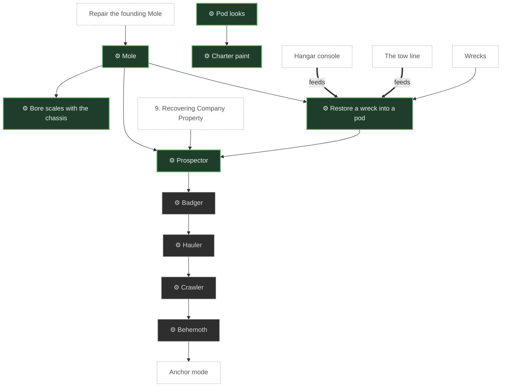

| Icon | Still | Feature | What it is | Status | Links |
|---|---|---|---|---|---|
|  | <a href="https://github.com/pkeppeler/deepcharter/blob/pr-media/looks/a-dusk-company/mole-unlit-day-front.jpg?raw=true"></a> | <a id="mole"></a>**Mole**<br>mechanic | The founding pod: 1 seat, parts up to tier 2, built for layers 1 and 2. 2 blocks wide and 3 tall. | ✅ Built | [ADR 0043](adr/0043-the-mole-is-tall-for-an-upright-pilot-and-the-ladder-is-the-bore-width.md), [ADR 0033](adr/0033-pod-models-are-item-models-and-the-figure-keeps-the-vanilla-model.md) |
| ⚙️ | <a href="https://github.com/pkeppeler/deepcharter/blob/pr-media/readme/pod-cutter-swap.gif?raw=true"></a> | <a id="pod-looks"></a>**Pod looks**<br>mechanic | A GeckoLib model per chassis; the drill tier picks the cutter on the front. | ✅ Built | [ADR 0040](adr/0040-a-pod-look-is-a-file-per-chassis-and-the-drill-tier-picks-the-cutter.md), [ADR 0038](adr/0038-pod-models-are-box-uv-bedrock-geometry-and-a-bone-name-says-how-it-moves.md) |
| ⚙️ | <a href="https://github.com/pkeppeler/deepcharter/blob/pr-media/looks/a-dusk-company/mole-lit-dark-front.jpg?raw=true"></a> | <a id="pod-paint"></a>**Charter paint**<br>mechanic | Pods are painted per charter and the rotor folds out to fly. | ✅ Built | [ADR 0041](adr/0041-pods-are-painted-per-charter-and-the-rotor-folds-out-to-fly.md) |
|  | <a href="https://github.com/pkeppeler/deepcharter/blob/pr-media/looks/a-dusk-company/prospector-unlit-day-front.jpg?raw=true"></a> | <a id="prospector"></a>**Prospector**<br>mechanic | A wreck from layer 2: 2 seats, parts up to tier 3, up to layer 3. | ✅ Built | [ADR 0027](adr/0027-a-chassis-is-an-entity-type-and-an-unowned-wreck-is-registered-when-restored.md), [SPEC.md](SPEC.md#chassis) |
| ⚙️ | <a href="https://github.com/pkeppeler/deepcharter/blob/pr-media/196/46-hangar-console-with-a-wreck-in-reach.png?raw=true"></a> | <a id="restore-wreck"></a>**Restore a wreck into a pod**<br>mechanic | Tow a wreck home and pay money plus catalysts at the hangar console. | ✅ Built | [ADR 0027](adr/0027-a-chassis-is-an-entity-type-and-an-unowned-wreck-is-registered-when-restored.md), [#196](https://github.com/pkeppeler/deepcharter/issues/196) |
| ⚙️ | no still yet | <a id="badger"></a>**Badger**<br>mechanic | A wreck from layer 3 or 4: 2 to 3 seats, adds the operator, leans to the drill. | 📋 Planned | [SPEC.md](SPEC.md#chassis) |
| ⚙️ | no still yet | <a id="bigger-bore"></a>**Bore scales with the chassis**<br>mechanic | A bigger pod carves a bigger tunnel, so its cab and bore grow together. | ✅ Built | [ADR 0043](adr/0043-the-mole-is-tall-for-an-upright-pilot-and-the-ladder-is-the-bore-width.md), [mechanics.md](design/mechanics.md#bore-size-and-the-economy-399) |
| ⚙️ | no still yet | <a id="hauler"></a>**Hauler**<br>mechanic | A wreck from layer 4 or 5: 3 seats, leans to cargo. Later the tender pod. | 📋 Planned | [SPEC.md](SPEC.md#chassis) |
| ⚙️ | no still yet | <a id="crawler"></a>**Crawler**<br>mechanic | A wreck from layer 6: 3 to 4 seats, leans to armour against heat and pressure. | 📋 Planned | [SPEC.md](SPEC.md#chassis) |
| ⚙️ | no still yet | <a id="behemoth"></a>**Behemoth**<br>mechanic | A wreck from layer 7: 4 to 6 seats and an anchor mode. | 📋 Planned | [SPEC.md](SPEC.md#chassis) |

### Drill

Faster boring, from the stock tricone to the sixth tier. Each tier changes the cutter on the front.

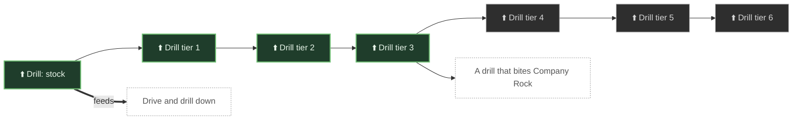

| Icon | Still | Feature | What it is | Status | Links |
|---|---|---|---|---|---|
|  | no still yet | <a id="drill-stock"></a>**Drill: stock**<br>upgrade | The stock tricone cutter. Speed 1x. | ✅ Built |  |
|  | no still yet | <a id="drill-t1"></a>**Drill tier 1**<br>upgrade | Drill speed 1.4x stock, $200. A Mole fits it. | ✅ Built | [SPEC.md](SPEC.md#components) |
|  | <a href="https://github.com/pkeppeler/deepcharter/blob/pr-media/readme/pod-cutter-swap.gif?raw=true"></a> | <a id="drill-t2"></a>**Drill tier 2**<br>upgrade | Stacked rings on the cutter, $500. The best a Mole takes. | ✅ Built | [SPEC.md](SPEC.md#components) |
|  | no still yet | <a id="drill-t3"></a>**Drill tier 3**<br>upgrade | Drill speed 2.5x stock, $1,250. The best a Prospector takes. | ✅ Built | [SPEC.md](SPEC.md#components) |
|  | no still yet | <a id="drill-t4"></a>**Drill tier 4**<br>upgrade | Drill speed 3.5x stock, $5,000. No chassis built yet can fit it (a Badger or later). | 📋 Planned | [SPEC.md](SPEC.md#components) |
|  | no still yet | <a id="drill-t5"></a>**Drill tier 5**<br>upgrade | Drill speed 4.75x stock, $25,000. No chassis built yet can fit it (a Badger or later). | 📋 Planned | [SPEC.md](SPEC.md#components) |
|  | no still yet | <a id="drill-t6"></a>**Drill tier 6**<br>upgrade | Drill speed 6.0x stock, $125,000. No chassis built yet can fit it (a Badger or later). | 📋 Planned | [SPEC.md](SPEC.md#components) |

### Hull

More hull to take lava, gas, crust and hard landings.

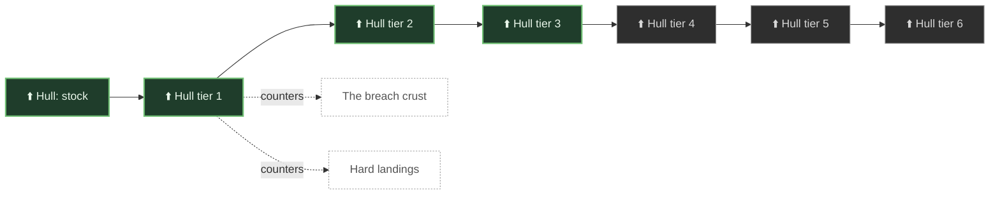

| Icon | Still | Feature | What it is | Status | Links |
|---|---|---|---|---|---|
|  | no still yet | <a id="hull-stock"></a>**Hull: stock**<br>upgrade | The stock hull. 1x. | ✅ Built |  |
|  | no still yet | <a id="hull-t1"></a>**Hull tier 1**<br>upgrade | Hull 1.7x stock, $200. A Mole fits it. | ✅ Built | [SPEC.md](SPEC.md#components) |
|  | no still yet | <a id="hull-t2"></a>**Hull tier 2**<br>upgrade | Hull 3.0x stock, $500. The best a Mole takes. | ✅ Built | [SPEC.md](SPEC.md#components) |
|  | no still yet | <a id="hull-t3"></a>**Hull tier 3**<br>upgrade | Hull 5.0x stock, $1,250. The best a Prospector takes. | ✅ Built | [SPEC.md](SPEC.md#components) |
|  | no still yet | <a id="hull-t4"></a>**Hull tier 4**<br>upgrade | Hull 8.0x stock, $5,000. No chassis built yet can fit it (a Badger or later). | 📋 Planned | [SPEC.md](SPEC.md#components) |
|  | no still yet | <a id="hull-t5"></a>**Hull tier 5**<br>upgrade | Hull 12.0x stock, $25,000. No chassis built yet can fit it (a Badger or later). | 📋 Planned | [SPEC.md](SPEC.md#components) |
|  | no still yet | <a id="hull-t6"></a>**Hull tier 6**<br>upgrade | Hull 18.0x stock, $125,000. No chassis built yet can fit it (a Badger or later). | 📋 Planned | [SPEC.md](SPEC.md#components) |

### Engine

More thrust for the rotor and treads.

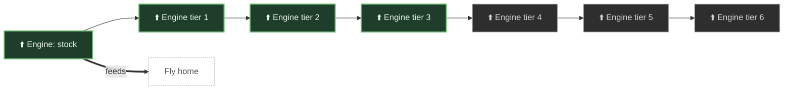

| Icon | Still | Feature | What it is | Status | Links |
|---|---|---|---|---|---|
|  | no still yet | <a id="engine-stock"></a>**Engine: stock**<br>upgrade | The stock engine. 1x. | ✅ Built |  |
|  | no still yet | <a id="engine-t1"></a>**Engine tier 1**<br>upgrade | Engine 1.07x stock, $200. A Mole fits it. | ✅ Built | [SPEC.md](SPEC.md#components) |
|  | no still yet | <a id="engine-t2"></a>**Engine tier 2**<br>upgrade | Engine 1.13x stock, $500. The best a Mole takes. | ✅ Built | [SPEC.md](SPEC.md#components) |
|  | no still yet | <a id="engine-t3"></a>**Engine tier 3**<br>upgrade | Engine 1.2x stock, $1,250. The best a Prospector takes. | ✅ Built | [SPEC.md](SPEC.md#components) |
|  | no still yet | <a id="engine-t4"></a>**Engine tier 4**<br>upgrade | Engine 1.27x stock, $5,000. No chassis built yet can fit it (a Badger or later). | 📋 Planned | [SPEC.md](SPEC.md#components) |
|  | no still yet | <a id="engine-t5"></a>**Engine tier 5**<br>upgrade | Engine 1.33x stock, $25,000. No chassis built yet can fit it (a Badger or later). | 📋 Planned | [SPEC.md](SPEC.md#components) |
|  | no still yet | <a id="engine-t6"></a>**Engine tier 6**<br>upgrade | Engine 1.4x stock, $125,000. No chassis built yet can fit it (a Badger or later). | 📋 Planned | [SPEC.md](SPEC.md#components) |

### Fuel tank

A bigger tank buys a longer dive.

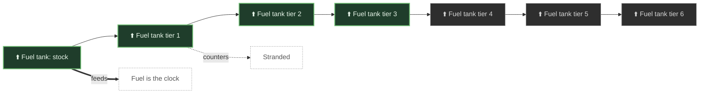

| Icon | Still | Feature | What it is | Status | Links |
|---|---|---|---|---|---|
|  | no still yet | <a id="fuel-tank-stock"></a>**Fuel tank: stock**<br>upgrade | The stock 10 litre tank. | ✅ Built |  |
|  | no still yet | <a id="fuel-tank-t1"></a>**Fuel tank tier 1**<br>upgrade | Tank 1.5x stock, $200. A Mole fits it. | ✅ Built | [SPEC.md](SPEC.md#components) |
|  | no still yet | <a id="fuel-tank-t2"></a>**Fuel tank tier 2**<br>upgrade | Tank 2.5x stock, $500. The best a Mole takes. | ✅ Built | [SPEC.md](SPEC.md#components) |
|  | no still yet | <a id="fuel-tank-t3"></a>**Fuel tank tier 3**<br>upgrade | Tank 4.0x stock, $1,250. The best a Prospector takes. | ✅ Built | [SPEC.md](SPEC.md#components) |
|  | no still yet | <a id="fuel-tank-t4"></a>**Fuel tank tier 4**<br>upgrade | Tank 6.0x stock, $5,000. No chassis built yet can fit it (a Badger or later). | 📋 Planned | [SPEC.md](SPEC.md#components) |
|  | no still yet | <a id="fuel-tank-t5"></a>**Fuel tank tier 5**<br>upgrade | Tank 10.0x stock, $25,000. No chassis built yet can fit it (a Badger or later). | 📋 Planned | [SPEC.md](SPEC.md#components) |
|  | no still yet | <a id="fuel-tank-t6"></a>**Fuel tank tier 6**<br>upgrade | Tank 15.0x stock, $125,000. No chassis built yet can fit it (a Badger or later). | 📋 Planned | [SPEC.md](SPEC.md#components) |

### Radiator

Cuts the heat the hull takes from lava; a vital part from the Magma Belt down.

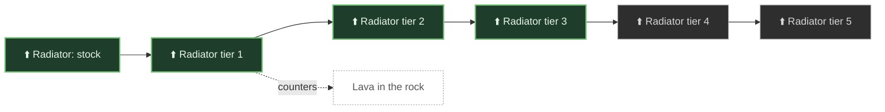

| Icon | Still | Feature | What it is | Status | Links |
|---|---|---|---|---|---|
|  | no still yet | <a id="radiator-stock"></a>**Radiator: stock**<br>upgrade | The stock radiator. Takes all the heat. | ✅ Built |  |
|  | no still yet | <a id="radiator-t1"></a>**Radiator tier 1**<br>upgrade | Lava costs 90 percent of stock, $500. A Mole fits it. | ✅ Built | [SPEC.md](SPEC.md#components) |
|  | no still yet | <a id="radiator-t2"></a>**Radiator tier 2**<br>upgrade | Lava costs 75 percent of stock, $1,250. The best a Mole takes. | ✅ Built | [SPEC.md](SPEC.md#components) |
|  | no still yet | <a id="radiator-t3"></a>**Radiator tier 3**<br>upgrade | Lava costs 60 percent of stock, $5,000. The best a Prospector takes. | ✅ Built | [SPEC.md](SPEC.md#components) |
|  | no still yet | <a id="radiator-t4"></a>**Radiator tier 4**<br>upgrade | Lava costs 40 percent of stock, $25,000. No chassis built yet can fit it (a Badger or later). | 📋 Planned | [SPEC.md](SPEC.md#components) |
|  | no still yet | <a id="radiator-t5"></a>**Radiator tier 5**<br>upgrade | Lava costs 20 percent of stock, $125,000. No chassis built yet can fit it (a Badger or later). | 📋 Planned | [SPEC.md](SPEC.md#components) |

### Cargo bay

More ore slots, so more per trip.

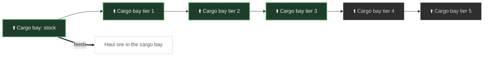

| Icon | Still | Feature | What it is | Status | Links |
|---|---|---|---|---|---|
|  | no still yet | <a id="cargo-bay-stock"></a>**Cargo bay: stock**<br>upgrade | The stock bay, 7 ore slots. | ✅ Built |  |
|  | no still yet | <a id="cargo-bay-t1"></a>**Cargo bay tier 1**<br>upgrade | 15 ore slots, $200. A Mole fits it. | ✅ Built | [SPEC.md](SPEC.md#components) |
|  | no still yet | <a id="cargo-bay-t2"></a>**Cargo bay tier 2**<br>upgrade | 25 ore slots, $500. The best a Mole takes. | ✅ Built | [SPEC.md](SPEC.md#components) |
|  | no still yet | <a id="cargo-bay-t3"></a>**Cargo bay tier 3**<br>upgrade | 40 ore slots, $1,250. The best a Prospector takes. | ✅ Built | [SPEC.md](SPEC.md#components) |
|  | no still yet | <a id="cargo-bay-t4"></a>**Cargo bay tier 4**<br>upgrade | 70 ore slots, $5,000. No chassis built yet can fit it (a Badger or later). | 📋 Planned | [SPEC.md](SPEC.md#components) |
|  | no still yet | <a id="cargo-bay-t5"></a>**Cargo bay tier 5**<br>upgrade | 120 ore slots, $25,000. No chassis built yet can fit it (a Badger or later). | 📋 Planned | [SPEC.md](SPEC.md#components) |

### Scanner

Range and what it can see: ore, then lava, then gas.

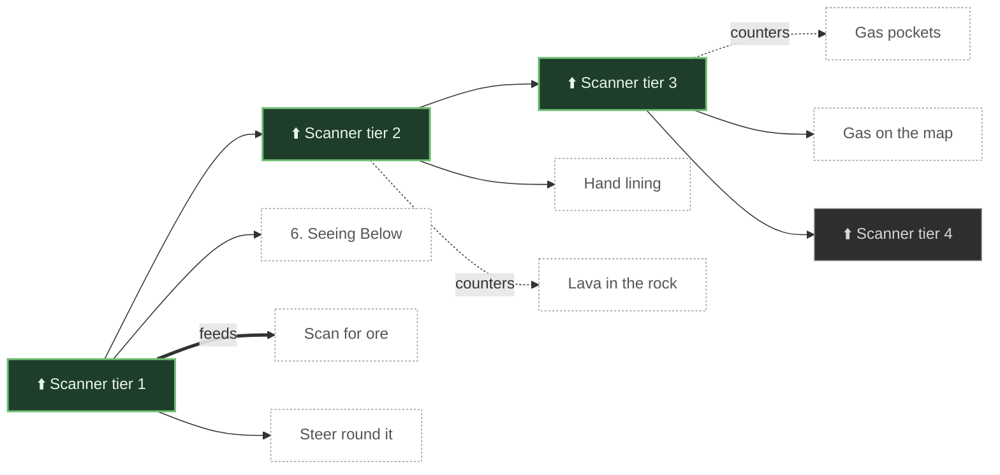

| Icon | Still | Feature | What it is | Status | Links |
|---|---|---|---|---|---|
|  | <a href="https://github.com/pkeppeler/deepcharter/blob/pr-media/readme/scanner-map.png?raw=true"></a> | <a id="scanner-t1"></a>**Scanner tier 1**<br>upgrade | The first map: ore in range. Crafted as a scanner unit and fitted by use, never sold at the terminal; every later tier is a purchase. A Mole fits it. | ✅ Built | [SPEC.md](SPEC.md#components), [#483](https://github.com/pkeppeler/deepcharter/issues/483), [#500](https://github.com/pkeppeler/deepcharter/issues/500) |
|  | no still yet | <a id="scanner-t2"></a>**Scanner tier 2**<br>upgrade | The thermal tier: lava shows bright red, lava in the wall dim red. $500, and tier 1 must be fitted first. The best a Mole takes. | ✅ Built | [SPEC.md](SPEC.md#components), [mechanics.md](design/mechanics.md#the-thermal-scanner-tier-300-a) |
|  | no still yet | <a id="scanner-t3"></a>**Scanner tier 3**<br>upgrade | Gas pockets show on the map. $1,250. The Prospector's tier. The best a Prospector takes. | ✅ Built | [SPEC.md](SPEC.md#components), [mechanics.md](design/mechanics.md#decision-gas-is-a-cap-and-gets-a-rung-a) |
|  | <a href="https://github.com/pkeppeler/deepcharter/blob/pr-media/looks/a-dusk-company/hud-scanner-tier-4-layer-2.jpg?raw=true"></a> | <a id="scanner-t4"></a>**Scanner tier 4**<br>upgrade | The widest, clearest map. $5,000. No chassis built yet can fit it (a Badger or later). | 📋 Planned | [SPEC.md](SPEC.md#components) |

### Lights

Pod lights are the only light below the surface; a brighter lamp lights more of the dark and keeps the Retained away.

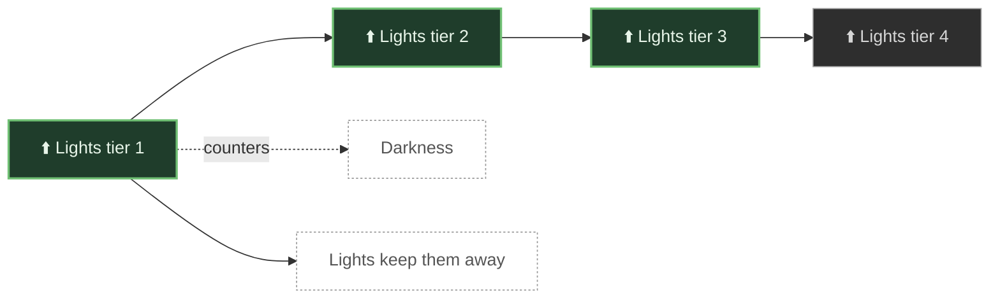

| Icon | Still | Feature | What it is | Status | Links |
|---|---|---|---|---|---|
|  | <a href="https://github.com/pkeppeler/deepcharter/blob/pr-media/readme/pod-lights.gif?raw=true"></a> | <a id="lights-t1"></a>**Lights tier 1**<br>upgrade | A first lamp, light level 6, $125. Lit pods draw no Retained. A Mole fits it. | ✅ Built | [SPEC.md](SPEC.md#components) |
|  | no still yet | <a id="lights-t2"></a>**Lights tier 2**<br>upgrade | Light level 9, $375. The best a Mole takes. | ✅ Built | [SPEC.md](SPEC.md#components) |
|  | no still yet | <a id="lights-t3"></a>**Lights tier 3**<br>upgrade | Light level 12, $1,250. The best a Prospector takes. | ✅ Built | [SPEC.md](SPEC.md#components) |
|  | no still yet | <a id="lights-t4"></a>**Lights tier 4**<br>upgrade | Light level 15, $3,750. No chassis built yet can fit it (a Badger or later). | 📋 Planned | [SPEC.md](SPEC.md#components) |

### The repair station's shelf

Single-use items bought at the repair station. Cheap tools first, then emergency ways home.

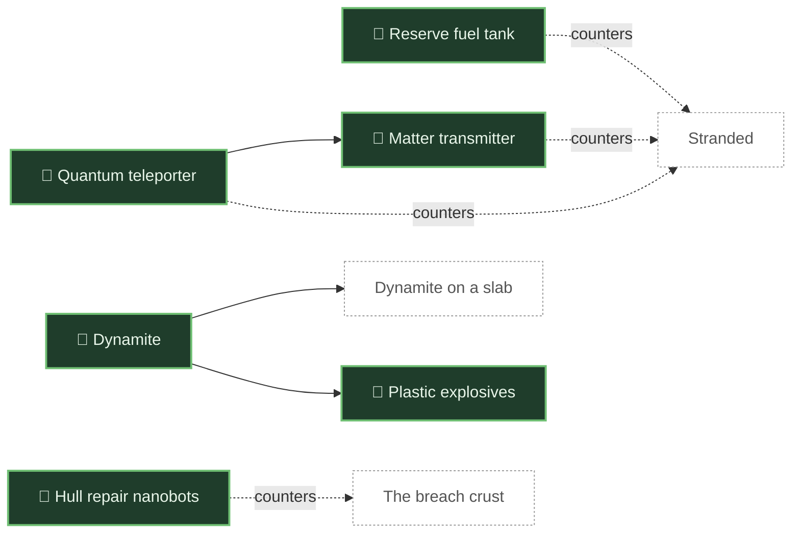

| Icon | Still | Feature | What it is | Status | Links |
|---|---|---|---|---|---|
|  | no still yet | <a id="dynamite"></a>**Dynamite**<br>consumable | A 3 by 3 blast for a blocked shaft or a known gas pocket. $100. | ✅ Built |  |
|  | no still yet | <a id="reserve-fuel-tank"></a>**Reserve fuel tank**<br>consumable | A bought reserve tank that restarts a stranded pod. $100. | ✅ Built |  |
|  | no still yet | <a id="hull-nanobots"></a>**Hull repair nanobots**<br>consumable | Patches the hull. $345. | ✅ Built |  |
|  | no still yet | <a id="plastic-explosives"></a>**Plastic explosives**<br>consumable | A 5 by 5 blast. $300. | ✅ Built |  |
|  | no still yet | <a id="quantum-teleporter"></a>**Quantum teleporter**<br>consumable | Sends you to the nearest pad or the surface; you drop your cargo. $690. | ✅ Built |  |
|  | <a href="https://github.com/pkeppeler/deepcharter/blob/pr-media/readme/repair-station.png?raw=true"></a> | <a id="matter-transmitter"></a>**Matter transmitter**<br>consumable | A dearer way home, with the same drop. $1,390. | ✅ Built |  |

### Crew roles and seats

The goal is crew, not passengers: each extra seat should have a real-time job that helps, and a pilot can do a weaker version alone. Passengers are allowed until the jobs exist. Provisional until a playtest.

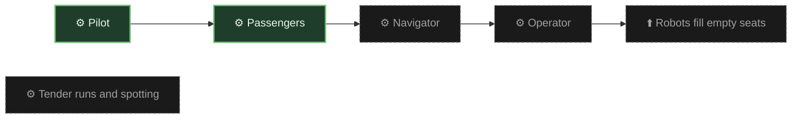

| Icon | Still | Feature | What it is | Status | Links |
|---|---|---|---|---|---|
| ⚙️ | no still yet | <a id="pilot"></a>**Pilot**<br>mechanic | The legs: movement, flight, fuel. | ✅ Built | [SPEC.md](SPEC.md#8-crew-roles-and-co-op-between-pods) |
| ⚙️ | no still yet | <a id="passengers"></a>**Passengers**<br>mechanic | A seat with no job is allowed: the Prospector's second seat carries a passenger until the navigator's sonar exists. | ✅ Built | [#507](https://github.com/pkeppeler/deepcharter/issues/507), [#511](https://github.com/pkeppeler/deepcharter/issues/511), [SPEC.md](SPEC.md#8-crew-roles-and-co-op-between-pods) |
| ⚙️ | no still yet | <a id="navigator"></a>**Navigator**<br>mechanic | The eyes: active sonar, pings that cost power, echoes that must be read, targets marked on the pilot's HUD. | 💭 Idea | [SPEC.md](SPEC.md#8-crew-roles-and-co-op-between-pods) |
| ⚙️ | no still yet | <a id="operator"></a>**Operator**<br>mechanic | The hands: a manipulator arm and a charge launcher; a turret later. | 💭 Idea | [SPEC.md](SPEC.md#8-crew-roles-and-co-op-between-pods) |
| ⬆️ | no still yet | <a id="robot-crew"></a>**Robots fill empty seats**<br>upgrade | A component that fills the navigator or operator seat with less skill. | 💭 Idea | [SPEC.md](SPEC.md#8-crew-roles-and-co-op-between-pods) |
| ⚙️ | no still yet | <a id="co-op-runs"></a>**Tender runs and spotting**<br>mechanic | One pod brings fuel and empty bays to a pod that keeps drilling; a second pod scans ahead. | 💭 Idea | [SPEC.md](SPEC.md#co-op-between-pods) |

### Cockpit, screens and HUD

Everything the player reads: the pod's gauges, the scanner map, the green-screen terminals, the handbook. All of it is resource-pack data, so a pack can restyle it.

```mermaid
flowchart TB
  n_altimeter["⚙️ Altimeter"]
  n_pod_status_hud["⚙️ Pod status readout"]
  n_account_hud["⚙️ Account readout"]
  n_scanner_hud["⚙️ Scanner map"]
  n_breach_fade["⚙️ Breach fade"]
  n_transmission_overlay["⚙️ Transmission overlay"]
  n_crt_terminals["⚙️ Green-screen terminal panels"]
  n_skins["⚙️ Skins"]
  n_ribbon_hud["⚙️ Cockpit HUD with gauges"]
  n_front_camera["⬆️ Front camera"]
  n_pod_status_hud --> n_scanner_hud
  n_ribbon_hud --> n_front_camera
  classDef built fill:#1f3d2b,stroke:#6fbf73,stroke-width:2px,color:#e8f5e9
  classDef progress fill:#4a3a10,stroke:#f0b429,stroke-width:2px,color:#fff3d6
  classDef planned fill:#2e2e2e,stroke:#9e9e9e,stroke-width:1px,color:#d6d6d6
  classDef idea fill:#1a1a1a,stroke:#757575,stroke-width:1px,stroke-dasharray:4 3,color:#a0a0a0
  classDef ext fill:#ffffff,stroke:#999999,stroke-width:1px,stroke-dasharray:2 2,color:#555555
  class n_altimeter,n_pod_status_hud,n_account_hud,n_scanner_hud,n_breach_fade,n_transmission_overlay,n_crt_terminals,n_skins built
  class n_ribbon_hud progress
  class n_front_camera planned
```

| Icon | Still | Feature | What it is | Status | Links |
|---|---|---|---|---|---|
| ⚙️ | <a href="https://github.com/pkeppeler/deepcharter/blob/pr-media/looks/a-dusk-company/hud-altimeter-layer-1-floor.jpg?raw=true"></a> | <a id="altimeter"></a>**Altimeter**<br>mechanic | Depth in feet, computed from the layer offset plus local height; each layer has its own trick. | ✅ Built | [ADR 0029](adr/0029-the-campaign-is-one-tall-world-and-the-uncharted-chain-joins-through-seams.md) |
| ⚙️ | <a href="https://github.com/pkeppeler/deepcharter/blob/pr-media/looks/a-dusk-company/hud-pod-status-and-altimeter-surface.jpg?raw=true"></a> | <a id="pod-status-hud"></a>**Pod status readout**<br>mechanic | Hull, fuel and cargo in the corner, with warning lines (HULL BURNING, SEEPAGE, CRUST). | ✅ Built | [ADR 0032](adr/0032-the-ui-theme-is-resource-pack-data-merged-key-by-key.md) |
| ⚙️ | no still yet | <a id="account-hud"></a>**Account readout**<br>mechanic | The charter's money, shown on the HUD. | ✅ Built | [ADR 0007](adr/0007-charters-are-one-versioned-saved-data.md) |
|  | <a href="https://github.com/pkeppeler/deepcharter/blob/pr-media/readme/scanner-map.png?raw=true"></a> | <a id="scanner-hud"></a>**Scanner map**<br>mechanic | A side-view slice with ore, lava and gas in their own colours. | ✅ Built | [SPEC.md](SPEC.md#scanner) |
| ⚙️ | <a href="https://github.com/pkeppeler/deepcharter/blob/pr-media/looks/a-dusk-company/hud-breach-fade.jpg?raw=true"></a> | <a id="breach-fade"></a>**Breach fade**<br>mechanic | The screen fades as the pod crosses a breach. | ✅ Built | [SPEC.md](SPEC.md#breaches) |
| ⚙️ | <a href="https://github.com/pkeppeler/deepcharter/blob/pr-media/readme/breach-transmission.png?raw=true"></a> | <a id="transmission-overlay"></a>**Transmission overlay**<br>mechanic | Employer messages on a green CRT screen that types out its text. | ✅ Built | [ADR 0012](adr/0012-transmissions-fire-once-per-charter-and-each-member-has-a-place.md) |
| ⚙️ | <a href="https://github.com/pkeppeler/deepcharter/blob/pr-media/readme/upgrade-terminal.png?raw=true"></a> | <a id="crt-terminals"></a>**Green-screen terminal panels**<br>mechanic | Every terminal is a Hatch machine panel: a green screen in a riveted frame with a status strip. | ✅ Built | [ADR 0042](adr/0042-the-terminal-panel-is-a-theme-area-with-fixed-sprite-slots.md), [ADR 0032](adr/0032-the-ui-theme-is-resource-pack-data-merged-key-by-key.md) |
| ⚙️ | no still yet | <a id="skins"></a>**Skins**<br>mechanic | Colours, sizes and timings are theme data; a resource pack restyles them with F3+T. | ✅ Built | [skins.md](design/skins.md), [ADR 0032](adr/0032-the-ui-theme-is-resource-pack-data-merged-key-by-key.md) |
| ⚙️ | no still yet | <a id="ribbon-hud"></a>**Cockpit HUD with gauges**<br>mechanic | A cockpit HUD with gauges that hides the vanilla hotbar while seated. | 🔨 In progress | [#247](https://github.com/pkeppeler/deepcharter/issues/247), [#520](https://github.com/pkeppeler/deepcharter/issues/520) |
| ⬆️ | no still yet | <a id="front-camera"></a>**Front camera**<br>upgrade | A part that turns the cab window into a video feed, clear to the edges, that lava can cook and static can cut. | 📋 Planned | [#448](https://github.com/pkeppeler/deepcharter/issues/448), [mechanics.md](design/mechanics.md#front-camera-448-a) |

## Challenge ladders

### Lava and its counters

Lava floods a bore through layer rock. The pod shields its pilot, so the hull is what lava costs. The ladder: see it, line the shaft by hand, line it automatically, hear it come, then shrug it off.

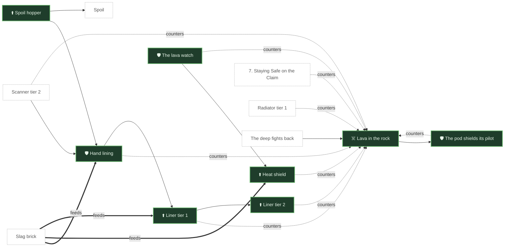

| Icon | Still | Feature | What it is | Status | Links |
|---|---|---|---|---|---|
| ☠️ | <a href="https://github.com/pkeppeler/deepcharter/blob/pr-media/readme/pod-lava.gif?raw=true"></a> | <a id="lava"></a>**Lava in the rock**<br>hazard | Pockets of lava from the Deep Claim down; a bore opens the cells beside it and the lava runs in. | ✅ Built | [mechanics.md](design/mechanics.md#lava-and-the-bore-231-232-288), [#232](https://github.com/pkeppeler/deepcharter/issues/232) |
| 🛡️ | <a href="https://github.com/pkeppeler/deepcharter/blob/pr-media/readme/pod-lava.gif?raw=true"></a> | <a id="pilot-shield"></a>**The pod shields its pilot**<br>counter | A seated pilot takes no lava damage; the hull burns instead, 10 a second, with a HULL BURNING readout and a hiss. | ✅ Built | [#288](https://github.com/pkeppeler/deepcharter/issues/288) |
|  | no still yet | <a id="spoil-hopper"></a>**Spoil hopper**<br>upgrade | The 'keep stone' part: the drill keeps spoil for bricks instead of destroying it. $100. | ✅ Built | [#313](https://github.com/pkeppeler/deepcharter/issues/313) |
| 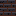 | <a href="https://github.com/pkeppeler/deepcharter/blob/pr-media/readme/pod-lining.png?raw=true"></a> | <a id="hand-lining"></a>**Hand lining**<br>counter | Press R from the seat and the pod lays slag brick round the slab while it stands still. | ✅ Built | [#313](https://github.com/pkeppeler/deepcharter/issues/313), [mechanics.md](design/mechanics.md#hand-lining-313-a) |
|  | <a href="https://github.com/pkeppeler/deepcharter/blob/pr-media/readme/pod-liner.png?raw=true"></a> | <a id="liner-t1"></a>**Liner tier 1**<br>upgrade | Lines the shaft with brick as the pod drills, every 4 slabs, only where lava can reach. $500. | ✅ Built | [#339](https://github.com/pkeppeler/deepcharter/issues/339), [mechanics.md](design/mechanics.md#liner-339-a) |
|  | <a href="https://github.com/pkeppeler/deepcharter/blob/pr-media/readme/pod-liner.png?raw=true"></a> | <a id="liner-t2"></a>**Liner tier 2**<br>upgrade | Rings every 3 slabs, also in a fall, and each brick lines more. $1,000. The best a Mole takes. | ✅ Built | [#339](https://github.com/pkeppeler/deepcharter/issues/339), [#432](https://github.com/pkeppeler/deepcharter/issues/432) |
| 🛡️ | <a href="https://github.com/pkeppeler/deepcharter/blob/pr-media/460/pod-lava-watch-plain.png?raw=true"></a> | <a id="lava-watch"></a>**The lava watch**<br>counter | A HUD line and lamp when flowing lava closes on the pod from behind; every pod has it, free. | ✅ Built | [#454](https://github.com/pkeppeler/deepcharter/issues/454), [mechanics.md](design/mechanics.md#the-lava-watch-454-a) |
|  | <a href="https://github.com/pkeppeler/deepcharter/blob/pr-media/501/pod-heat-shield.gif?raw=true"></a> | <a id="heat-shield"></a>**Heat shield**<br>upgrade | A one-tier part, $750. While lava touches the pod, burning slag bricks soak its damage at 4 hull a brick, from the rack first and then the pilot's pack. The HUD shows GLAZE HOLDING or GLAZE SPENT. | ✅ Built | [#482](https://github.com/pkeppeler/deepcharter/issues/482), [#501](https://github.com/pkeppeler/deepcharter/issues/501), [#232](https://github.com/pkeppeler/deepcharter/issues/232) |

### Gas and its counters

Gas pockets look like stone and blast the hull when the drill opens them; damage grows with depth. Steer round them, hear them, then bleed them.

```mermaid
flowchart LR
  n_gas_pocket["☠️ Gas pockets"]
  n_dynamite_aim["🛡️ Dynamite on a slab"]
  n_sounder_t1["⬆️ Seep sounder tier 1"]
  n_sounder_t2["⬆️ Seep sounder tier 2"]
  n_sideways_share["🛡️ Sideways bores spread the blast"]
  n_scanner_gas["🛡️ Gas on the map"]
  n_dynamite["Dynamite"]
  n_scanner_t3["Scanner tier 3"]
  n_the_deep_bites["The deep fights back"]
  n_dynamite --> n_dynamite_aim
  n_dynamite_aim -. counters .-> n_gas_pocket
  n_scanner_gas -. counters .-> n_gas_pocket
  n_scanner_t3 -. counters .-> n_gas_pocket
  n_scanner_t3 --> n_scanner_gas
  n_sideways_share -. counters .-> n_gas_pocket
  n_sounder_t1 -. counters .-> n_gas_pocket
  n_sounder_t1 --> n_sounder_t2
  n_sounder_t2 -. counters .-> n_gas_pocket
  n_the_deep_bites --> n_gas_pocket
  classDef built fill:#1f3d2b,stroke:#6fbf73,stroke-width:2px,color:#e8f5e9
  classDef progress fill:#4a3a10,stroke:#f0b429,stroke-width:2px,color:#fff3d6
  classDef planned fill:#2e2e2e,stroke:#9e9e9e,stroke-width:1px,color:#d6d6d6
  classDef idea fill:#1a1a1a,stroke:#757575,stroke-width:1px,stroke-dasharray:4 3,color:#a0a0a0
  classDef ext fill:#ffffff,stroke:#999999,stroke-width:1px,stroke-dasharray:2 2,color:#555555
  class n_gas_pocket,n_dynamite_aim,n_sounder_t1,n_sounder_t2,n_sideways_share,n_scanner_gas built
  class n_dynamite,n_scanner_t3,n_the_deep_bites ext
```

| Icon | Still | Feature | What it is | Status | Links |
|---|---|---|---|---|---|
| ☠️ | no still yet | <a id="gas-pocket"></a>**Gas pockets**<br>hazard | A pocket that looks like plain stone and blasts the hull when bored; the biggest cause of deaths in layer 1. | ✅ Built | [mechanics.md](design/mechanics.md#gas-and-the-bore-368-a), [#368](https://github.com/pkeppeler/deepcharter/issues/368) |
|  | no still yet | <a id="dynamite-aim"></a>**Dynamite on a slab**<br>counter | Blast a pocket from a distance, if you know where it is. Costly. | ✅ Built | [SPEC.md](SPEC.md#10-hazards) |
|  | <a href="https://github.com/pkeppeler/deepcharter/blob/pr-media/readme/pod-sounder.png?raw=true"></a> | <a id="sounder-t1"></a>**Seep sounder tier 1**<br>upgrade | A SEEPAGE readout counts the slabs down to a pocket and a hiss quickens as the drill nears. $400. | ✅ Built | [#373](https://github.com/pkeppeler/deepcharter/issues/373), [mechanics.md](design/mechanics.md#seep-sounder-373-a) |
|  | <a href="https://github.com/pkeppeler/deepcharter/blob/pr-media/readme/pod-sounder.png?raw=true"></a> | <a id="sounder-t2"></a>**Seep sounder tier 2**<br>upgrade | Reaches 4 slabs down and 2 blocks to each side, and bleeds a marked pocket before boring it. $1,000. | ✅ Built | [#373](https://github.com/pkeppeler/deepcharter/issues/373) |
| 🛡️ | no still yet | <a id="sideways-share"></a>**Sideways bores spread the blast**<br>counter | A pod that opens a pocket sideways takes only a share of the blast, per cell of its slab. | ✅ Built | [#424](https://github.com/pkeppeler/deepcharter/issues/424), [mechanics.md](design/mechanics.md#gas-on-the-taller-mole-424-a) |
|  | no still yet | <a id="scanner-gas"></a>**Gas on the map**<br>counter | Scanner tier 3, on the Prospector, draws pockets in its slice; the sounder stays the cheap Mole part. | ✅ Built | [mechanics.md](design/mechanics.md#decision-gas-is-a-cap-and-gets-a-rung-a) |

### Company Rock and its counters

Company Rock is a block in the layers that the drill refuses and a hand cannot break. A pilot can steer round it for free, or buy a blasting charge to clear it and keep a straight shaft; a shaped charge clears a whole column of it, and a Prospector's best drill bites it slowly.

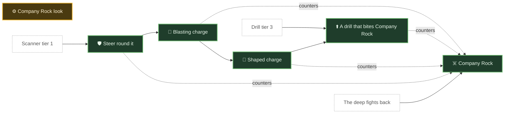

| Icon | Still | Feature | What it is | Status | Links |
|---|---|---|---|---|---|
|  | no still yet | <a id="company-rock"></a>**Company Rock**<br>hazard | Rock the drill refuses. Steer round it (fuel, time, the next pocket) or blast it with a charge, or bite it with the Prospector's best drill, to keep the shaft straight. | ✅ Built | [ADR 0015](adr/0015-zones-are-filled-block-by-block-from-the-originals-rows.md), [#509](https://github.com/pkeppeler/deepcharter/issues/509), [#503](https://github.com/pkeppeler/deepcharter/issues/503) |
| ⚙️ | <a href="https://github.com/pkeppeler/deepcharter/blob/pr-media/523/place-bore.png?raw=true"></a> | <a id="company-rock-look"></a>**Company Rock look**<br>mechanic | A concept round for how Company Rock looks is under way; the chosen look is built later. | 🔨 In progress | [#503](https://github.com/pkeppeler/deepcharter/issues/503), [company-rock-concepts.md](design/company-rock-concepts.md) |
| 🛡️ | no still yet | <a id="sidestep"></a>**Steer round it**<br>counter | Step the pod aside and drill on; the scanner shows nothing of it. | ✅ Built |  |
|  | <a href="https://github.com/pkeppeler/deepcharter/blob/pr-media/527/pod-charge-hole.png?raw=true"></a> | <a id="blasting-charge"></a>**Blasting charge**<br>consumable | A $40 charge set from the seat under the pod. After a 3 second fuse it clears Company Rock and the rock round it, and hurts a pod that stays within 3 blocks. About 5 a straight layer 1 shaft. | ✅ Built | [#509](https://github.com/pkeppeler/deepcharter/issues/509), [ADR 0050](adr/0050-company-rock-can-be-blasted-and-the-drill-still-refuses-it.md), [mechanics.md](design/mechanics.md#company-rock-and-the-straight-shaft-509-a) |
|  | no still yet | <a id="shaped-charge"></a>**Shaped charge**<br>consumable | A $100 charge set like the blasting charge. Its blast is directed down: it clears the whole Company Rock column under the pod, up to 8 rows, and stops at the first other block. It will not be set over lava. | ✅ Built | [#526](https://github.com/pkeppeler/deepcharter/issues/526), [ADR 0052](adr/0052-the-prospectors-best-drill-bites-company-rock-and-a-shaped-charge-clears-a-column.md), [mechanics.md](design/mechanics.md#the-shaped-charge-526-a) |
|  | no still yet | <a id="rock-drill-tier"></a>**A drill that bites Company Rock**<br>upgrade | From drill tier 3 (a Prospector's best) the drill bores Company Rock: ten times slower than stone, three times the fuel, and the cutter heats the hull. A Mole never bites; a hull of 20 or less stops it. | ✅ Built | [#526](https://github.com/pkeppeler/deepcharter/issues/526), [ADR 0052](adr/0052-the-prospectors-best-drill-bites-company-rock-and-a-shaped-charge-clears-a-column.md), [mechanics.md](design/mechanics.md#the-drill-that-bites-526-a) |

### The Retained and other creatures

The Retained are tall, thin, lampless figures that come to dark pods and drain their fuel. They never attack. Lights keep them away, and a grab ends only when the figure is killed: by the pod's drill, or a sword on foot.

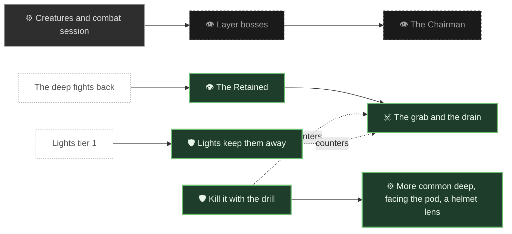

| Icon | Still | Feature | What it is | Status | Links |
|---|---|---|---|---|---|
| 👁️ | <a href="https://github.com/pkeppeler/deepcharter/blob/pr-media/looks/a-dusk-company/lampless-figure-front.jpg?raw=true"></a> | <a id="retained"></a>**The Retained**<br>creature | A lampless figure in the open dark of layers 1 and 2, drawn to pods with no lights; about a third carry a small lamp. It never attacks and never speaks. | ✅ Built | [ADR 0046](adr/0046-the-retained-are-a-monster-that-never-attacks-and-the-lamp-carrier-has-its-own-files.md), [ADR 0044](adr/0044-the-lampless-figure-is-a-geckolib-model-and-the-reacher.md), [#449](https://github.com/pkeppeler/deepcharter/issues/449) |
| ☠️ | <a href="https://github.com/pkeppeler/deepcharter/blob/pr-media/readme/reacher.png?raw=true"></a> | <a id="retained-grab"></a>**The grab and the drain**<br>hazard | It walks to a pod within 20 blocks, clings to the hull and drains fuel, never below 5 percent. The grip ends only when the figure dies. | ✅ Built | [ADR 0046](adr/0046-the-retained-are-a-monster-that-never-attacks-and-the-lamp-carrier-has-its-own-files.md), [mechanics.md](design/mechanics.md#the-retained-at-dark-pods-449-a) |
|  | <a href="https://github.com/pkeppeler/deepcharter/blob/pr-media/readme/pod-lights.gif?raw=true"></a> | <a id="retained-lights"></a>**Lights keep them away**<br>counter | A pod with a lights part draws no Retained. Lights do not free a pod that is already held. | ✅ Built | [#449](https://github.com/pkeppeler/deepcharter/issues/449) |
|  | <a href="https://github.com/pkeppeler/deepcharter/blob/pr-media/498/retained-drain.gif?raw=true"></a> | <a id="retained-kill"></a>**Kill it with the drill**<br>counter | No fading: a grab ends only when the Retained dies. The cutter bites it while the pod drills rock, and a sword kills it on foot. | ✅ Built | [#485](https://github.com/pkeppeler/deepcharter/issues/485), [#498](https://github.com/pkeppeler/deepcharter/issues/498), [ADR 0046](adr/0046-the-retained-are-a-monster-that-never-attacks-and-the-lamp-carrier-has-its-own-files.md) |
| ⚙️ | <a href="https://github.com/pkeppeler/deepcharter/blob/pr-media/515/retained-drain.gif?raw=true"></a> | <a id="retained-tuning"></a>**More common deep, facing the pod, a helmet lens**<br>mechanic | Layer 1 rolls 1 percent and layer 2 5 percent, up to 5 at once; a figure faces the pod it grips; a tiny dim amber lens shines in its helmet. | ✅ Built | [#506](https://github.com/pkeppeler/deepcharter/issues/506), [#515](https://github.com/pkeppeler/deepcharter/issues/515), [ADR 0046](adr/0046-the-retained-are-a-monster-that-never-attacks-and-the-lamp-carrier-has-its-own-files.md) |
| ⚙️ | no still yet | <a id="creatures-session"></a>**Creatures and combat session**<br>mechanic | A session with the user on rare unsettling creatures per layer and bosses; pod combat uses mining gear first. | 📋 Planned | [#13](https://github.com/pkeppeler/deepcharter/issues/13), [SPEC.md](SPEC.md#13-creatures-and-combat) |
| 👁️ | no still yet | <a id="layer-bosses"></a>**Layer bosses**<br>creature | Bosses that mix pod fights and on-foot fights, by layer. | 💭 Idea | [SPEC.md](SPEC.md#13-creatures-and-combat) |
| 👁️ | no still yet | <a id="the-chairman"></a>**The Chairman**<br>creature | The two-phase finale boss, broken but never killed. | 💭 Idea | [ADR 0031](adr/0031-the-finale-is-won-by-renunciation.md) |

### Darkness and sight

Below the surface there is no sky. An unlit cave is almost black, a stranded pod goes dark, and the Company's cheerful signs explain less the deeper you go.

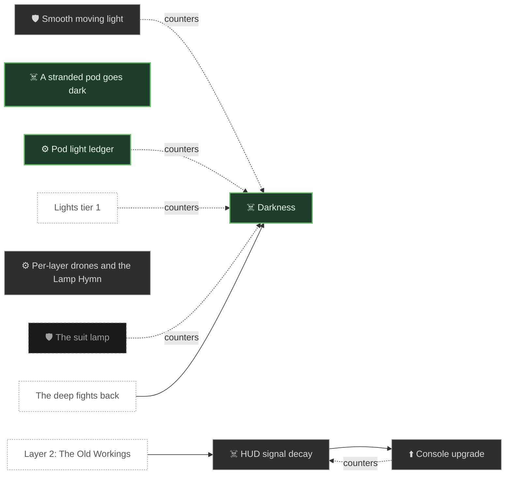

| Icon | Still | Feature | What it is | Status | Links |
|---|---|---|---|---|---|
| ☠️ | <a href="https://github.com/pkeppeler/deepcharter/blob/pr-media/looks/a-dusk-company/layer-1-cave-as-played-no-light.jpg?raw=true"></a> | <a id="darkness"></a>**Darkness**<br>hazard | Each layer sets its own ambient light, darker with depth. Pod lights are the only light you have. | ✅ Built | [SPEC.md](SPEC.md#darkness) |
| ⚙️ | <a href="https://github.com/pkeppeler/deepcharter/blob/pr-media/readme/pod-lights.gif?raw=true"></a> | <a id="light-ledger"></a>**Pod light ledger**<br>mechanic | A pod's light blocks are recorded in a ledger before they are placed, so they move with the pod and clear when it leaves. | ✅ Built | [ADR 0024](adr/0024-pod-light-blocks-are-recorded-in-a-ledger-before-they-are-placed.md) |
| ☠️ | <a href="https://github.com/pkeppeler/deepcharter/blob/pr-media/readme/wreck.png?raw=true"></a> | <a id="stranded-dark"></a>**A stranded pod goes dark**<br>hazard | With no fuel or hull the pod is powered off, and its lights go out. | ✅ Built | [SPEC.md](SPEC.md#fuel-and-stranded) |
| 🛡️ | no still yet | <a id="dynamic-lights"></a>**Smooth moving light**<br>counter | Glow accents, beams, an optional dynamic-lights mod and an opt-in shader pack. | 📋 Planned | [#248](https://github.com/pkeppeler/deepcharter/issues/248) |
| 🛡️ | no still yet | <a id="suit-lamp"></a>**The suit lamp**<br>counter | On foot, a suit lamp on a battery; the finale's Unnumbered Lamp never runs out. | 💭 Idea | [SPEC.md](SPEC.md#9-on-foot) |
| ☠️ | no still yet | <a id="signal-decay"></a>**HUD signal decay**<br>hazard | Near the bottom of a layer the readouts flicker, jump and finally drop out; the deeper, the more often. | 📋 Planned | [#502](https://github.com/pkeppeler/deepcharter/issues/502) |
| ⬆️ | no still yet | <a id="console-upgrade"></a>**Console upgrade**<br>upgrade | A cockpit track whose tiers push the decay deeper; the top tier is immune. | 📋 Planned | [#502](https://github.com/pkeppeler/deepcharter/issues/502) |
| ⚙️ | no still yet | <a id="lamp-hymn"></a>**Per-layer drones and the Lamp Hymn**<br>mechanic | Each layer gets its own sound drone, with a hymn motif. | 📋 Planned | [#249](https://github.com/pkeppeler/deepcharter/issues/249) |

### The breach crust and hard landings

The hull is the pod's life. A fall, a crust and the layers' hazards all spend it; a pod with none left is a wreck.

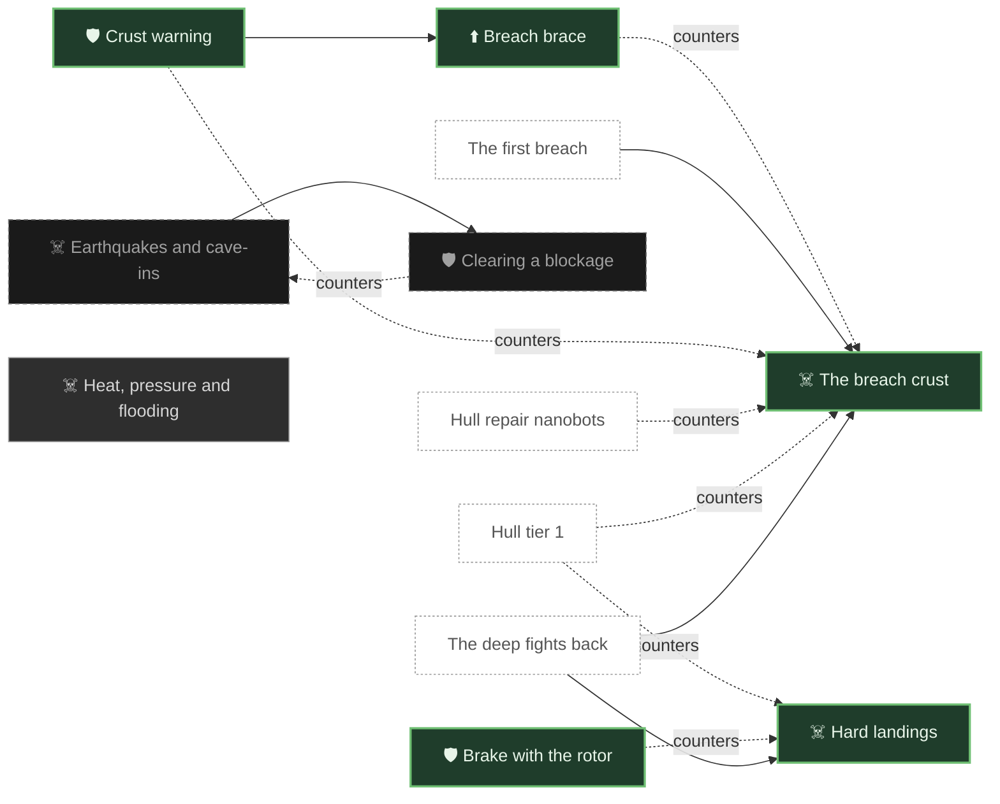

| Icon | Still | Feature | What it is | Status | Links |
|---|---|---|---|---|---|
| ☠️ | no still yet | <a id="hard-landing"></a>**Hard landings**<br>hazard | The hull takes damage from the sink speed at landing; a pilot who taps the rotor lands unhurt from any height. | ✅ Built | [#319](https://github.com/pkeppeler/deepcharter/issues/319), [ADR 0035](adr/0035-pod-landing-damage-reads-impact-speed.md), [mechanics.md](design/mechanics.md#hard-landings-319-a) |
|  | no still yet | <a id="rotor-braking"></a>**Brake with the rotor**<br>counter | Holding the sink speed under 14 blocks a second costs fuel and saves the hull. | ✅ Built | [#319](https://github.com/pkeppeler/deepcharter/issues/319) |
|  | <a href="https://github.com/pkeppeler/deepcharter/blob/pr-media/looks/a-dusk-company/layer-1-breach-crust-floor.jpg?raw=true"></a> | <a id="breach-crust"></a>**The breach crust**<br>hazard | Three rows of hard rock at each layer floor: 8 hull a row, 24 in all, and heat. | ✅ Built | [#378](https://github.com/pkeppeler/deepcharter/issues/378), [mechanics.md](design/mechanics.md#the-breach-crust-378-a) |
| 🛡️ | <a href="https://github.com/pkeppeler/deepcharter/blob/pr-media/readme/breach-brace.png?raw=true"></a> | <a id="crust-warning"></a>**Crust warning**<br>counter | An amber line within 16 slabs of the crust says how much hull you have and what it will take. | ✅ Built | [#378](https://github.com/pkeppeler/deepcharter/issues/378) |
|  | <a href="https://github.com/pkeppeler/deepcharter/blob/pr-media/readme/breach-brace.png?raw=true"></a> | <a id="brace-t1"></a>**Breach brace**<br>upgrade | At rest above the crust the brace burns the cheapest ore to patch hull. $200. Fits every chassis. | ✅ Built | [#378](https://github.com/pkeppeler/deepcharter/issues/378), [mechanics.md](design/mechanics.md#the-rung-a-crust-warning-for-every-pod-and-the-breach-brace-part) |
| ☠️ | no still yet | <a id="quakes"></a>**Earthquakes and cave-ins**<br>hazard | In certain layers a quake or cave-in blocks a stretch of shaft, small or large; it never deletes built blocks. | 💭 Idea | [SPEC.md](SPEC.md#10-hazards) |
| 🛡️ | no still yet | <a id="clear-blockage"></a>**Clearing a blockage**<br>counter | Explosives on foot, a pod charge launcher, crewmates from above, or an emergency teleport. | 💭 Idea | [SPEC.md](SPEC.md#10-hazards) |
| ☠️ | no still yet | <a id="deep-heat-pressure"></a>**Heat, pressure and flooding**<br>hazard | Later layers add heat (the Magma Belt), pressure and flooding (the Drowned Deep) that the hull and radiator must answer. | 📋 Planned | [SPEC.md](SPEC.md#story-layers) |

### Stranded, rescue and the way home

Fuel is the clock. Running dry strands the pod, and a pod with no hull is a wreck. Getting back up is staged: carried fuel, tow lines, emergency teleports, then outposts and pads.

```mermaid
flowchart TB
  n_stranded["☠️ Stranded"]
  n_refuel_by_hand["🛡️ Refuel by hand"]
  n_reserve_tank["🛡️ Reserve tank"]
  n_tow_line["🛡️ The tow line"]
  n_wreck["⚙️ Wrecks"]
  n_tow_chain_look["⚙️ A chain, not smoke"]
  n_wreck_salvage_prefabs["⚙️ Wrecked prefabs that drop salvage"]
  n_outpost["📍 Outposts at depth"]
  n_outpost_ratings["⚙️ Environment ratings"]
  n_pads["📍 Teleport pads"]
  n_anchor_mode["⚙️ Anchor mode"]
  n_behemoth["Behemoth"]
  n_fuel_tank_t1["Fuel tank tier 1"]
  n_matter_transmitter["Matter transmitter"]
  n_quantum_teleporter["Quantum teleporter"]
  n_reserve_fuel_tank["Reserve fuel tank"]
  n_restore_wreck["Restore a wreck into a pod"]
  n_the_deep_bites["The deep fights back"]
  n_behemoth --> n_anchor_mode
  n_fuel_tank_t1 -. counters .-> n_stranded
  n_matter_transmitter -. counters .-> n_stranded
  n_outpost --> n_outpost_ratings
  n_outpost --> n_pads
  n_quantum_teleporter -. counters .-> n_stranded
  n_refuel_by_hand -. counters .-> n_stranded
  n_reserve_fuel_tank -. counters .-> n_stranded
  n_reserve_tank -. counters .-> n_stranded
  n_stranded --> n_refuel_by_hand
  n_the_deep_bites --> n_stranded
  n_tow_line == feeds ==> n_restore_wreck
  n_tow_line -. counters .-> n_stranded
  n_tow_line --> n_tow_chain_look
  n_wreck --> n_restore_wreck
  classDef built fill:#1f3d2b,stroke:#6fbf73,stroke-width:2px,color:#e8f5e9
  classDef progress fill:#4a3a10,stroke:#f0b429,stroke-width:2px,color:#fff3d6
  classDef planned fill:#2e2e2e,stroke:#9e9e9e,stroke-width:1px,color:#d6d6d6
  classDef idea fill:#1a1a1a,stroke:#757575,stroke-width:1px,stroke-dasharray:4 3,color:#a0a0a0
  classDef ext fill:#ffffff,stroke:#999999,stroke-width:1px,stroke-dasharray:2 2,color:#555555
  class n_stranded,n_refuel_by_hand,n_reserve_tank,n_tow_line,n_wreck,n_tow_chain_look built
  class n_wreck_salvage_prefabs,n_outpost,n_outpost_ratings,n_pads planned
  class n_anchor_mode idea
  class n_behemoth,n_fuel_tank_t1,n_matter_transmitter,n_quantum_teleporter,n_reserve_fuel_tank,n_restore_wreck,n_the_deep_bites ext
```

| Icon | Still | Feature | What it is | Status | Links |
|---|---|---|---|---|---|
| ☠️ | <a href="https://github.com/pkeppeler/deepcharter/blob/pr-media/readme/wreck.png?raw=true"></a> | <a id="stranded"></a>**Stranded**<br>hazard | Out of fuel, the pod is powered off and dark until rescue or a reserve tank. | ✅ Built | [SPEC.md](SPEC.md#fuel-and-stranded) |
|  | no still yet | <a id="refuel-by-hand"></a>**Refuel by hand**<br>counter | Right-click the pod with coal, charcoal or biofuel; 2 litres each. | ✅ Built | [PLAYING.md](PLAYING.md) |
|  | no still yet | <a id="reserve-tank"></a>**Reserve tank**<br>counter | A tank crafted from iron and a bucket that restarts a stranded pod. | ✅ Built | [ADR 0019](adr/0019-the-reserve-tank-is-a-separate-pod-attachment.md) |
|  | <a href="https://github.com/pkeppeler/deepcharter/blob/pr-media/readme/towing.gif?raw=true"></a> | <a id="tow-line"></a>**The tow line**<br>counter | Hold a tow cable and right-click another pod; the towed pod hangs below and behind on a 5 block line, across breaches. | ✅ Built | [ADR 0022](adr/0022-a-tow-cable-is-an-attachment-on-the-towed-pod-and-the-tower-carries-it-across.md), [#425](https://github.com/pkeppeler/deepcharter/issues/425), [mechanics.md](design/mechanics.md#the-tow-line-425-a) |
| ⚙️ | <a href="https://github.com/pkeppeler/deepcharter/blob/pr-media/readme/wreck.png?raw=true"></a> | <a id="wreck"></a>**Wrecks**<br>mechanic | A pod with no hull goes dark where it fell, with its cargo, and its owners are told. | ✅ Built | [ADR 0027](adr/0027-a-chassis-is-an-entity-type-and-an-unowned-wreck-is-registered-when-restored.md), [SPEC.md](SPEC.md#12-death-and-failure) |
|  | <a href="https://github.com/pkeppeler/deepcharter/blob/pr-media/522/chain-hanging-close.png?raw=true"></a> | <a id="tow-chain-look"></a>**A chain, not smoke**<br>mechanic | The tow line is a real chain of links on a sagging curve: it hangs when slack, goes straight when pulled, and shows in the dark of a layer. | ✅ Built | [#508](https://github.com/pkeppeler/deepcharter/issues/508), [#522](https://github.com/pkeppeler/deepcharter/issues/522), [ADR 0049](adr/0049-the-tow-line-is-a-chain-the-client-draws-from-the-attachment.md) |
| ⚙️ | no still yet | <a id="wreck-salvage-prefabs"></a>**Wrecked prefabs that drop salvage**<br>mechanic | Ruined buildings and vehicles in the world that give scrap when broken. | 📋 Planned | [#471](https://github.com/pkeppeler/deepcharter/issues/471) |
| 📍 | no still yet | <a id="outpost"></a>**Outposts at depth**<br>place | Built shelters with fuel and sell terminals, beds and storage; the first goes at the layer 1 floor. | 📋 Planned | [#320](https://github.com/pkeppeler/deepcharter/issues/320), [SPEC.md](SPEC.md#outposts-and-ratings) |
| ⚙️ | no still yet | <a id="outpost-ratings"></a>**Environment ratings**<br>mechanic | Each depth rates heat, pressure, flooding and quakes; an outpost under the rating is uninhabitable but never destroyed. | 📋 Planned | [SPEC.md](SPEC.md#outposts-and-ratings) |
| 📍 | no still yet | <a id="pads"></a>**Teleport pads**<br>place | Paired pads a charter builds, at a power cost that grows with depth and mass; nothing mined teleports. | 📋 Planned | [SPEC.md](SPEC.md#pads) |
| ⚙️ | no still yet | <a id="anchor-mode"></a>**Anchor mode**<br>mechanic | A parked Behemoth unfolds into a walkable temporary outpost. | 💭 Idea | [SPEC.md](SPEC.md#chassis) |

## Goal ladders

### Bootstrap: salvage to the first run

There is no tree and no ore on the surface. Salvage crates and fungal stalks give wood and metal; the metal builds the terminal parts; the terminals bring the colony back; the Mole goes down.

```mermaid
flowchart TB
  n_fungal_stalks["💎 Fungal stalks"]
  n_salvage_crate["💎 Salvage crates"]
  n_salvage_cloth["💎 Salvage cloth"]
  n_scrap_metal["💎 Scrap iron and copper"]
  n_furnace_scrap["⚙️ Melt scrap in a furnace"]
  n_craft_tools["🎯 Tools, a table and a torch"]
  n_craft_terminal_parts["🎯 Craft the terminal parts"]
  n_repair_terminals["🎯 Repair the terminals in order"]
  n_craft_mole_parts["🎯 Craft the Mole's parts"]
  n_scanner_from_crafting["🎯 Craft the first scanner"]
  n_repair_mole["🎯 Repair the founding Mole"]
  n_first_run["🎯 The first run"]
  n_crate_press["Press spoil into salvage crates"]
  n_fuel_pump["Fuel pump"]
  n_mole["Mole"]
  n_craft_mole_parts --> n_repair_mole
  n_craft_terminal_parts --> n_repair_terminals
  n_craft_tools --> n_craft_terminal_parts
  n_crate_press == feeds ==> n_salvage_crate
  n_fungal_stalks --> n_furnace_scrap
  n_furnace_scrap --> n_craft_tools
  n_repair_mole --> n_first_run
  n_repair_mole --> n_mole
  n_repair_terminals --> n_craft_mole_parts
  n_repair_terminals --> n_fuel_pump
  n_salvage_crate --> n_salvage_cloth
  n_salvage_crate --> n_scrap_metal
  n_scanner_from_crafting --> n_first_run
  n_scrap_metal --> n_furnace_scrap
  classDef built fill:#1f3d2b,stroke:#6fbf73,stroke-width:2px,color:#e8f5e9
  classDef progress fill:#4a3a10,stroke:#f0b429,stroke-width:2px,color:#fff3d6
  classDef planned fill:#2e2e2e,stroke:#9e9e9e,stroke-width:1px,color:#d6d6d6
  classDef idea fill:#1a1a1a,stroke:#757575,stroke-width:1px,stroke-dasharray:4 3,color:#a0a0a0
  classDef ext fill:#ffffff,stroke:#999999,stroke-width:1px,stroke-dasharray:2 2,color:#555555
  class n_fungal_stalks,n_salvage_crate,n_salvage_cloth,n_scrap_metal,n_furnace_scrap,n_craft_tools,n_craft_terminal_parts,n_repair_terminals,n_craft_mole_parts,n_scanner_from_crafting,n_repair_mole,n_first_run built
  class n_crate_press,n_fuel_pump,n_mole ext
```

| Icon | Still | Feature | What it is | Status | Links |
|---|---|---|---|---|---|
| 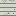 | <a href="https://github.com/pkeppeler/deepcharter/blob/pr-media/519/stalk-b-crater.png?raw=true"></a> | <a id="fungal-stalks"></a>**Fungal stalks**<br>resource | Pale stalks on crater floors are the wood: press to planks, burn for heat, char to charcoal. | ✅ Built | [#245](https://github.com/pkeppeler/deepcharter/issues/245), [ADR 0047](adr/0047-the-surface-has-no-ore-the-bootstraps-metal-is-salvage-and-the-yard-is-a-biome.md) |
| 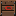 | <a href="https://github.com/pkeppeler/deepcharter/blob/pr-media/465/salvage-gather.gif?raw=true"></a> | <a id="salvage-crate"></a>**Salvage crates**<br>resource | Company crates in a ring 100 to 160 blocks out; break one for planks, sticks, cloth, scrap and redstone. | ✅ Built | [#245](https://github.com/pkeppeler/deepcharter/issues/245), [ADR 0047](adr/0047-the-surface-has-no-ore-the-bootstraps-metal-is-salvage-and-the-yard-is-a-biome.md), [mechanics.md](design/mechanics.md#early-ore-access-salvage-245-a) |
|  | no still yet | <a id="salvage-cloth"></a>**Salvage cloth**<br>resource | Cloth from a crate; it crafts into string. | ✅ Built |  |
|  | no still yet | <a id="scrap-metal"></a>**Scrap iron and copper**<br>resource | The crate's metal; melted one for one in a furnace. | ✅ Built |  |
| ⚙️ | no still yet | <a id="furnace-scrap"></a>**Melt scrap in a furnace**<br>mechanic | Planks burn to melt scrap into iron and copper ingots. | ✅ Built |  |
| 🎯 | no still yet | <a id="craft-tools"></a>**Tools, a table and a torch**<br>goal | Handbook chapter 1: craft stone tools, then a first light. | ✅ Built | [#245](https://github.com/pkeppeler/deepcharter/issues/245) |
| 🎯 | no still yet | <a id="craft-terminal-parts"></a>**Craft the terminal parts**<br>goal | Ten crafted parts, from iron, copper and redstone, repair the four colony terminals. | ✅ Built | [ADR 0014](adr/0014-terminal-repair-is-one-world-wide-chain.md) |
|  | <a href="https://github.com/pkeppeler/deepcharter/blob/pr-media/readme/colony-terminals.png?raw=true"></a> | <a id="repair-terminals"></a>**Repair the terminals in order**<br>goal | Pump, processor, upgrade terminal, repair station, each once per world. | ✅ Built | [ADR 0014](adr/0014-terminal-repair-is-one-world-wide-chain.md) |
|  | no still yet | <a id="craft-mole-parts"></a>**Craft the Mole's parts**<br>goal | A drill head, a fuel injector, a rotor hub and a tread assembly bring the founding Mole back. | ✅ Built | [ADR 0021](adr/0021-the-hangar-is-a-terminal-and-its-repair-founds-the-mole.md) |
|  | <a href="https://github.com/pkeppeler/deepcharter/blob/pr-media/500/crafted-scanner.gif?raw=true"></a> | <a id="scanner-from-crafting"></a>**Craft the first scanner**<br>goal | Craft a scanner unit from 4 iron, 2 copper and 2 redstone and use it on your pod: that fits the tier 1 scanner. The terminal does not sell tier 1. | ✅ Built | [#483](https://github.com/pkeppeler/deepcharter/issues/483), [#500](https://github.com/pkeppeler/deepcharter/issues/500) |
| 🎯 | <a href="https://github.com/pkeppeler/deepcharter/blob/pr-media/looks/a-dusk-company/hangar-founding-mole-repaired.jpg?raw=true"></a> | <a id="repair-mole"></a>**Repair the founding Mole**<br>goal | The first charter fixes the hangar's Mole; the Company advances the pod. | ✅ Built | [ADR 0021](adr/0021-the-hangar-is-a-terminal-and-its-repair-founds-the-mole.md) |
| 🎯 | <a href="https://github.com/pkeppeler/deepcharter/blob/pr-media/readme/hero.gif?raw=true"></a> | <a id="first-run"></a>**The first run**<br>goal | Refuel, scan, drill layer 1, sell, buy a first part. | ✅ Built | [PLAYING.md](PLAYING.md) |

### The colony's terminals

Each terminal is a Company machine, dead until its parts go in, and the repairs form a chain. One repair serves every charter in the world.

```mermaid
flowchart LR
  n_contract_terminal["🖥️ Contract terminal"]
  n_fuel_pump["🖥️ Fuel pump"]
  n_ore_processor["🖥️ Ore processor"]
  n_upgrade_terminal["🖥️ Upgrade terminal"]
  n_repair_station["🖥️ Repair station"]
  n_hangar_console["🖥️ Hangar console"]
  n_parked_pod_rule["⚙️ Parked pod uses the terminal"]
  n_outpost_terminals["🖥️ Outpost terminals"]
  n_buy_consumables["Buy repairs and consumables"]
  n_buy_fuel["Buy fuel at the pump"]
  n_buy_parts["Buy pod parts"]
  n_colony_hangar["The hangar"]
  n_conduit["The Conduit"]
  n_found_charter["Found a charter"]
  n_repair_terminals["Repair the terminals in order"]
  n_restore_wreck["Restore a wreck into a pod"]
  n_sell_ore["Sell ore for money"]
  n_colony_hangar --> n_hangar_console
  n_contract_terminal --> n_found_charter
  n_fuel_pump --> n_buy_fuel
  n_fuel_pump --> n_ore_processor
  n_hangar_console == feeds ==> n_restore_wreck
  n_ore_processor --> n_conduit
  n_ore_processor --> n_sell_ore
  n_ore_processor --> n_upgrade_terminal
  n_repair_station --> n_buy_consumables
  n_repair_station --> n_hangar_console
  n_repair_terminals --> n_fuel_pump
  n_upgrade_terminal --> n_buy_parts
  n_upgrade_terminal --> n_outpost_terminals
  n_upgrade_terminal --> n_repair_station
  classDef built fill:#1f3d2b,stroke:#6fbf73,stroke-width:2px,color:#e8f5e9
  classDef progress fill:#4a3a10,stroke:#f0b429,stroke-width:2px,color:#fff3d6
  classDef planned fill:#2e2e2e,stroke:#9e9e9e,stroke-width:1px,color:#d6d6d6
  classDef idea fill:#1a1a1a,stroke:#757575,stroke-width:1px,stroke-dasharray:4 3,color:#a0a0a0
  classDef ext fill:#ffffff,stroke:#999999,stroke-width:1px,stroke-dasharray:2 2,color:#555555
  class n_contract_terminal,n_fuel_pump,n_ore_processor,n_upgrade_terminal,n_repair_station,n_hangar_console,n_parked_pod_rule built
  class n_outpost_terminals planned
  class n_buy_consumables,n_buy_fuel,n_buy_parts,n_colony_hangar,n_conduit,n_found_charter,n_repair_terminals,n_restore_wreck,n_sell_ore ext
```

| Icon | Still | Feature | What it is | Status | Links |
|---|---|---|---|---|---|
|  | <a href="https://github.com/pkeppeler/deepcharter/blob/pr-media/looks/a-dusk-company/screen-contract-terminal.jpg?raw=true"></a> | <a id="contract-terminal"></a>**Contract terminal**<br>terminal | Works from the start: found a charter or sign on as crew. | ✅ Built | [ADR 0018](adr/0018-the-contract-terminal-sends-its-own-state-by-name.md), [#129](https://github.com/pkeppeler/deepcharter/issues/129) |
|  | <a href="https://github.com/pkeppeler/deepcharter/blob/pr-media/readme/fuel-pump.png?raw=true"></a> | <a id="fuel-pump"></a>**Fuel pump**<br>terminal | Sells fuel to a parked pod. The first repair. | ✅ Built | [ADR 0014](adr/0014-terminal-repair-is-one-world-wide-chain.md), [ADR 0023](adr/0023-a-terminal-view-carries-its-types-feature-and-a-parked-pod-is-one-rule.md) |
|  | <a href="https://github.com/pkeppeler/deepcharter/blob/pr-media/looks/a-dusk-company/screen-ore-processor-online.jpg?raw=true"></a> | <a id="ore-processor"></a>**Ore processor**<br>terminal | Buys ore, fuses slag brick, presses crates, lists work orders. | ✅ Built | [ADR 0014](adr/0014-terminal-repair-is-one-world-wide-chain.md), [ADR 0023](adr/0023-a-terminal-view-carries-its-types-feature-and-a-parked-pod-is-one-rule.md) |
|  | <a href="https://github.com/pkeppeler/deepcharter/blob/pr-media/readme/upgrade-terminal.png?raw=true"></a> | <a id="upgrade-terminal"></a>**Upgrade terminal**<br>terminal | Sells tiered pod parts. | ✅ Built | [ADR 0014](adr/0014-terminal-repair-is-one-world-wide-chain.md), [ADR 0023](adr/0023-a-terminal-view-carries-its-types-feature-and-a-parked-pod-is-one-rule.md) |
|  | <a href="https://github.com/pkeppeler/deepcharter/blob/pr-media/readme/repair-station.png?raw=true"></a> | <a id="repair-station"></a>**Repair station**<br>terminal | Mends the hull and sells consumables. | ✅ Built | [ADR 0014](adr/0014-terminal-repair-is-one-world-wide-chain.md), [ADR 0023](adr/0023-a-terminal-view-carries-its-types-feature-and-a-parked-pod-is-one-rule.md) |
|  | <a href="https://github.com/pkeppeler/deepcharter/blob/pr-media/looks/a-dusk-company/screen-hangar-console-online.jpg?raw=true"></a> | <a id="hangar-console"></a>**Hangar console**<br>terminal | Founds the Mole, restores wrecks into pods and buys a refurbished Mole for later charters. | ✅ Built | [ADR 0021](adr/0021-the-hangar-is-a-terminal-and-its-repair-founds-the-mole.md), [ADR 0027](adr/0027-a-chassis-is-an-entity-type-and-an-unowned-wreck-is-registered-when-restored.md) |
| ⚙️ | no still yet | <a id="parked-pod-rule"></a>**Parked pod uses the terminal**<br>mechanic | Park a pod beside a terminal and it works on the pod, not on the player. | ✅ Built | [ADR 0023](adr/0023-a-terminal-view-carries-its-types-feature-and-a-parked-pod-is-one-rule.md) |
| 🖥️ | no still yet | <a id="outpost-terminals"></a>**Outpost terminals**<br>terminal | Fuel and sell terminals built at depth, selling at worse rates than the colony. | 📋 Planned | [#320](https://github.com/pkeppeler/deepcharter/issues/320), [SPEC.md](SPEC.md#outposts-and-ratings) |

### The Employee Handbook

Nine chapters of directives that tick off by themselves as you play, then Notes found in the world. It teaches the rules; the world stays a mystery.

```mermaid
flowchart TB
  n_handbook_item["⚙️ The handbook item"]
  n_hb_welcome["🎯 1. Welcome to Prosperity"]
  n_hb_back_online["🎯 2. Bringing Prosperity Back Online"]
  n_hb_meet_the_mole["🎯 3. Meet the Mole"]
  n_hb_fuel_is_life["🎯 4. Fuel Is Life"]
  n_hb_every_sale_counts["🎯 5. Every Sale Counts"]
  n_hb_seeing_below["🎯 6. Seeing Below"]
  n_handbook_hazard_tooltip["⚙️ Hazards on higher scanners"]
  n_hb_staying_safe["🎯 7. Staying Safe on the Claim"]
  n_hb_first_breach["🎯 8. Your First Breach"]
  n_hb_company_property["🎯 9. Recovering Company Property"]
  n_handbook_notes["⚙️ Notes"]
  n_handbook_revisions["⚙️ Revisions"]
  n_spec_sheets["⚙️ Spec sheets and first-exposure warnings"]
  n_found_charter["Found a charter"]
  n_lava["Lava in the rock"]
  n_prospector["Prospector"]
  n_scanner_t1["Scanner tier 1"]
  n_found_charter --> n_handbook_item
  n_handbook_item --> n_hb_welcome
  n_handbook_notes --> n_handbook_revisions
  n_handbook_notes --> n_spec_sheets
  n_hb_back_online --> n_hb_meet_the_mole
  n_hb_company_property --> n_handbook_notes
  n_hb_company_property --> n_prospector
  n_hb_every_sale_counts --> n_hb_seeing_below
  n_hb_first_breach --> n_hb_company_property
  n_hb_fuel_is_life --> n_hb_every_sale_counts
  n_hb_meet_the_mole --> n_hb_fuel_is_life
  n_hb_seeing_below --> n_hb_staying_safe
  n_hb_staying_safe --> n_hb_first_breach
  n_hb_staying_safe -. counters .-> n_lava
  n_hb_welcome --> n_hb_back_online
  n_scanner_t1 --> n_hb_seeing_below
  classDef built fill:#1f3d2b,stroke:#6fbf73,stroke-width:2px,color:#e8f5e9
  classDef progress fill:#4a3a10,stroke:#f0b429,stroke-width:2px,color:#fff3d6
  classDef planned fill:#2e2e2e,stroke:#9e9e9e,stroke-width:1px,color:#d6d6d6
  classDef idea fill:#1a1a1a,stroke:#757575,stroke-width:1px,stroke-dasharray:4 3,color:#a0a0a0
  classDef ext fill:#ffffff,stroke:#999999,stroke-width:1px,stroke-dasharray:2 2,color:#555555
  class n_handbook_item,n_hb_welcome,n_hb_back_online,n_hb_meet_the_mole,n_hb_fuel_is_life,n_hb_every_sale_counts,n_hb_seeing_below,n_hb_staying_safe,n_hb_first_breach,n_hb_company_property,n_handbook_notes built
  class n_handbook_hazard_tooltip,n_handbook_revisions,n_spec_sheets planned
  class n_found_charter,n_lava,n_prospector,n_scanner_t1 ext
```

| Icon | Still | Feature | What it is | Status | Links |
|---|---|---|---|---|---|
|  | <a href="https://github.com/pkeppeler/deepcharter/blob/pr-media/readme/handbook.png?raw=true"></a> | <a id="handbook-item"></a>**The handbook item**<br>mechanic | Issued when you sign your contract, bound to you, opened with H. | ✅ Built | [ADR 0005](adr/0005-build-our-own-handbook.md) |
|  | <a href="https://github.com/pkeppeler/deepcharter/blob/pr-media/readme/handbook.png?raw=true"></a> | <a id="hb-welcome"></a>**1. Welcome to Prosperity**<br>goal | Gather wood, craft tools, gather scrap, smelt iron, craft a scanner unit. | ✅ Built | [ADR 0013](adr/0013-handbook-chapters-are-data-and-directives-are-advancements.md), [ADR 0028](adr/0028-chapters-one-to-five-complete-from-the-events-that-own-the-deed.md), [SPEC.md](SPEC.md#chapters) |
|  | no still yet | <a id="hb-back-online"></a>**2. Bringing Prosperity Back Online**<br>goal | Repair the pump, the processor and the upgrade terminal. | ✅ Built | [ADR 0013](adr/0013-handbook-chapters-are-data-and-directives-are-advancements.md), [ADR 0028](adr/0028-chapters-one-to-five-complete-from-the-events-that-own-the-deed.md), [SPEC.md](SPEC.md#chapters) |
|  | no still yet | <a id="hb-meet-the-mole"></a>**3. Meet the Mole**<br>goal | Repair the Mole and board it. | ✅ Built | [ADR 0013](adr/0013-handbook-chapters-are-data-and-directives-are-advancements.md), [ADR 0028](adr/0028-chapters-one-to-five-complete-from-the-events-that-own-the-deed.md), [SPEC.md](SPEC.md#chapters) |
|  | no still yet | <a id="hb-fuel-is-life"></a>**4. Fuel Is Life**<br>goal | Refuel, fly, drill down and return to the colony. | ✅ Built | [ADR 0013](adr/0013-handbook-chapters-are-data-and-directives-are-advancements.md), [ADR 0028](adr/0028-chapters-one-to-five-complete-from-the-events-that-own-the-deed.md), [SPEC.md](SPEC.md#chapters) |
|  | no still yet | <a id="hb-every-sale-counts"></a>**5. Every Sale Counts**<br>goal | Sell ore, buy a component, install it. | ✅ Built | [ADR 0013](adr/0013-handbook-chapters-are-data-and-directives-are-advancements.md), [ADR 0028](adr/0028-chapters-one-to-five-complete-from-the-events-that-own-the-deed.md), [SPEC.md](SPEC.md#chapters) |
|  | no still yet | <a id="hb-seeing-below"></a>**6. Seeing Below**<br>goal | Install the scanner and find ore with it. | ✅ Built | [ADR 0013](adr/0013-handbook-chapters-are-data-and-directives-are-advancements.md), [ADR 0028](adr/0028-chapters-one-to-five-complete-from-the-events-that-own-the-deed.md), [SPEC.md](SPEC.md#chapters) |
| ⚙️ | no still yet | <a id="handbook-hazard-tooltip"></a>**Hazards on higher scanners**<br>mechanic | A handbook line about unseen hazards that a thermal tier shows; its wording is a user pick. | 📋 Planned | [#306](https://github.com/pkeppeler/deepcharter/issues/306) |
|  | no still yet | <a id="hb-staying-safe"></a>**7. Staying Safe on the Claim**<br>goal | Repair the hull and reach the Deep Claim. | ✅ Built | [ADR 0013](adr/0013-handbook-chapters-are-data-and-directives-are-advancements.md), [ADR 0028](adr/0028-chapters-one-to-five-complete-from-the-events-that-own-the-deed.md), [SPEC.md](SPEC.md#chapters) |
|  | no still yet | <a id="hb-first-breach"></a>**8. Your First Breach**<br>goal | Break through the crust into layer 2. | ✅ Built | [ADR 0013](adr/0013-handbook-chapters-are-data-and-directives-are-advancements.md), [ADR 0028](adr/0028-chapters-one-to-five-complete-from-the-events-that-own-the-deed.md), [SPEC.md](SPEC.md#chapters) |
|  | no still yet | <a id="hb-company-property"></a>**9. Recovering Company Property**<br>goal | Find the Prospector wreck, tow it, restore it, reach layer 2's floor. | ✅ Built | [ADR 0013](adr/0013-handbook-chapters-are-data-and-directives-are-advancements.md), [ADR 0028](adr/0028-chapters-one-to-five-complete-from-the-events-that-own-the-deed.md), [SPEC.md](SPEC.md#chapters) |
| 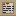 | <a href="https://github.com/pkeppeler/deepcharter/blob/pr-media/looks/a-dusk-company/handbook-notes-tab.jpg?raw=true"></a> | <a id="handbook-notes"></a>**Notes**<br>mechanic | Miners' scribbles, torn pages and wreck logs found in the world; one found by anyone fills every member's handbook. | ✅ Built | [ADR 0020](adr/0020-notes-are-found-by-the-charter-and-read-by-the-player.md), [notes.md](lore/notes.md) |
| ⚙️ | no still yet | <a id="handbook-revisions"></a>**Revisions**<br>mechanic | The handbook is revised five times as the story turns; tone changes, rules never do. | 📋 Planned | [handbook.md](lore/handbook.md) |
| ⚙️ | no still yet | <a id="spec-sheets"></a>**Spec sheets and first-exposure warnings**<br>mechanic | After layer 2, each new rule is explained when you first meet it, not by a chapter. | 📋 Planned | [SPEC.md](SPEC.md#the-world-is-a-mystery-the-rules-never-are) |

### Layers, breaches and the story

A chain of layers, each with three zones, joined by breach crusts. Layers 1 and 2 exist; the rest of the eight story layers, the Ramp and the uncharted worlds are planned.

```mermaid
flowchart TB
  n_surface["📍 The surface"]
  n_layer_1["📍 Layer 1: The Claim"]
  n_l1_topsoil["📍 Topsoil Claims"]
  n_l1_benches["📍 Stone Benches"]
  n_l1_deep["📍 Deep Claim"]
  n_layer_structures["📍 Structures in the layers"]
  n_breach_1["📍 The first breach"]
  n_deepest_point["⚙️ Deepest point"]
  n_transmissions["⚙️ Transmissions"]
  n_layer_2["📍 Layer 2: The Old Workings"]
  n_layer_depth_look["⚙️ Layer rock textures and grades"]
  n_l2_upper["📍 Upper Levels"]
  n_l2_shift["📍 Shift Change"]
  n_l2_run["📍 Prospector's Run"]
  n_breach_in_world["⚙️ Breach crossing with no teleport"]
  n_campaign_world["⚙️ One tall campaign world"]
  n_layer_3["📍 Layer 3: Fungal Hollows"]
  n_layer_4["📍 Layer 4: The Drowned Deep"]
  n_layers_5_8["📍 Layers 5 to 8"]
  n_finale["🎯 The finale: a choice"]
  n_ramp["📍 The Ramp"]
  n_seams["⚙️ Seams and the grained crust"]
  n_splice["⚙️ Story-layer splicing"]
  n_uncharted["📍 Uncharted layers"]
  n_breach_crust["The breach crust"]
  n_signal_decay["HUD signal decay"]
  n_work_orders["Work orders"]
  n_breach_1 --> n_breach_crust
  n_breach_1 --> n_layer_2
  n_campaign_world --> n_breach_in_world
  n_campaign_world --> n_seams
  n_deepest_point --> n_work_orders
  n_finale --> n_ramp
  n_l1_benches --> n_l1_deep
  n_l1_deep --> n_breach_1
  n_l1_topsoil --> n_l1_benches
  n_l2_run --> n_layer_3
  n_l2_shift --> n_l2_run
  n_l2_upper --> n_l2_shift
  n_layer_1 --> n_l1_topsoil
  n_layer_2 --> n_l2_upper
  n_layer_2 --> n_signal_decay
  n_layer_3 --> n_layer_4
  n_layer_4 --> n_layers_5_8
  n_layers_5_8 --> n_finale
  n_ramp --> n_uncharted
  n_seams --> n_splice
  n_surface --> n_layer_1
  classDef built fill:#1f3d2b,stroke:#6fbf73,stroke-width:2px,color:#e8f5e9
  classDef progress fill:#4a3a10,stroke:#f0b429,stroke-width:2px,color:#fff3d6
  classDef planned fill:#2e2e2e,stroke:#9e9e9e,stroke-width:1px,color:#d6d6d6
  classDef idea fill:#1a1a1a,stroke:#757575,stroke-width:1px,stroke-dasharray:4 3,color:#a0a0a0
  classDef ext fill:#ffffff,stroke:#999999,stroke-width:1px,stroke-dasharray:2 2,color:#555555
  class n_surface,n_layer_1,n_l1_topsoil,n_l1_benches,n_l1_deep,n_layer_structures,n_breach_1,n_deepest_point,n_transmissions,n_layer_2,n_l2_upper,n_l2_shift,n_l2_run built
  class n_layer_depth_look progress
  class n_breach_in_world,n_campaign_world,n_layer_3,n_layer_4,n_layers_5_8,n_finale,n_ramp,n_seams,n_splice planned
  class n_uncharted idea
  class n_breach_crust,n_signal_decay,n_work_orders ext
```

| Icon | Still | Feature | What it is | Status | Links |
|---|---|---|---|---|---|
|  | <a href="https://github.com/pkeppeler/deepcharter/blob/pr-media/looks/a-dusk-company/surface-south-dusk.jpg?raw=true"></a> | <a id="surface"></a>**The surface**<br>place | Regolith plains, craters and terraced mesas under a dusk sky that never reaches day. No ore, no trees. | ✅ Built | [ADR 0036](adr/0036-the-surface-is-generated-from-data-by-a-replaced-overworld-dimension.md), [art-direction.md](design/art-direction.md) |
| 📍 | <a href="https://github.com/pkeppeler/deepcharter/blob/pr-media/looks/a-dusk-company/layer-1-cave-north.jpg?raw=true"></a> | <a id="layer-1"></a>**Layer 1: The Claim**<br>place | Dirt and stone, the first ores and the previous miners' shafts. Teaches the loop. | ✅ Built | [SPEC.md](SPEC.md#story-layers) |
|  | <a href="https://github.com/pkeppeler/deepcharter/blob/pr-media/looks/a-dusk-company/structure-topsoil-shaft-looking-down.jpg?raw=true"></a> | <a id="l1-topsoil"></a>**Topsoil Claims**<br>place | The top third of layer 1. | ✅ Built |  |
|  | <a href="https://github.com/pkeppeler/deepcharter/blob/pr-media/looks/a-dusk-company/structure-benches-shaft-looking-down.jpg?raw=true"></a> | <a id="l1-benches"></a>**Stone Benches**<br>place | The middle third of layer 1. | ✅ Built |  |
|  | <a href="https://github.com/pkeppeler/deepcharter/blob/pr-media/looks/a-dusk-company/structure-deep-shaft-looking-down.jpg?raw=true"></a> | <a id="l1-deep"></a>**Deep Claim**<br>place | The bottom third of layer 1, where lava starts. | ✅ Built |  |
| 📍 | <a href="https://github.com/pkeppeler/deepcharter/blob/pr-media/looks/a-dusk-company/structure-gallery-quota-board.jpg?raw=true"></a> | <a id="layer-structures"></a>**Structures in the layers**<br>place | Shafts with Note niches, a punch clock, a gallery with a quota board, rails and timbering, and wreck sites. | ✅ Built | [ADR 0025](adr/0025-layer-structures-are-drawn-from-the-seed-when-a-fresh-chunk-loads.md) |
| 📍 | <a href="https://github.com/pkeppeler/deepcharter/blob/pr-media/looks/a-dusk-company/layer-1-breach-crust-floor.jpg?raw=true"></a> | <a id="breach-1"></a>**The first breach**<br>place | A crust at the layer's floor: any drill gets through, slowly, hot and hurt. A rumble and a transmission mark the crossing. | ✅ Built | [SPEC.md](SPEC.md#breaches), [#378](https://github.com/pkeppeler/deepcharter/issues/378) |
| ⚙️ | <a href="https://github.com/pkeppeler/deepcharter/blob/pr-media/480/deepest-point-layer-1.png?raw=true"></a> | <a id="deepest-point"></a>**Deepest point**<br>mechanic | A charter's deepest point sets which orders and transmissions open. | ✅ Built | [#476](https://github.com/pkeppeler/deepcharter/issues/476), [mechanics.md](design/mechanics.md#the-deepest-point-476) |
| ⚙️ | <a href="https://github.com/pkeppeler/deepcharter/blob/pr-media/readme/breach-transmission.png?raw=true"></a> | <a id="transmissions"></a>**Transmissions**<br>mechanic | The story arrives as green-screen messages that fire once per charter, mostly at its deepest point. | ✅ Built | [ADR 0012](adr/0012-transmissions-fire-once-per-charter-and-each-member-has-a-place.md), [transmissions.md](lore/transmissions.md) |
| 📍 | <a href="https://github.com/pkeppeler/deepcharter/blob/pr-media/looks/a-dusk-company/layer-2-cave-north.jpg?raw=true"></a> | <a id="layer-2"></a>**Layer 2: The Old Workings**<br>place | Collapsed mine levels, rails, a salvageable Prospector wreck, garbled transmissions. | ✅ Built | [SPEC.md](SPEC.md#story-layers) |
| ⚙️ | no still yet | <a id="layer-depth-look"></a>**Layer rock textures and grades**<br>mechanic | Grained rock textures for layers 1 and 2, a lava redraw and an I-beam fix; depth palettes and colour grades follow. | 🔨 In progress | [#241](https://github.com/pkeppeler/deepcharter/issues/241) |
|  | <a href="https://github.com/pkeppeler/deepcharter/blob/pr-media/looks/a-dusk-company/structure-rails-long-drift.jpg?raw=true"></a> | <a id="l2-upper"></a>**Upper Levels**<br>place | The top third of layer 2. | ✅ Built |  |
|  | <a href="https://github.com/pkeppeler/deepcharter/blob/pr-media/looks/a-dusk-company/structure-punch-clock-overview.jpg?raw=true"></a> | <a id="l2-shift"></a>**Shift Change**<br>place | The middle third of layer 2, where Cicatrium first appears. | ✅ Built |  |
|  | <a href="https://github.com/pkeppeler/deepcharter/blob/pr-media/looks/a-dusk-company/structure-wreck-prospector-0002.jpg?raw=true"></a> | <a id="l2-run"></a>**Prospector's Run**<br>place | The bottom third of layer 2, with the Prospector wreck. | ✅ Built |  |
| ⚙️ | no still yet | <a id="breach-in-world"></a>**Breach crossing with no teleport**<br>mechanic | Crossing a breach inside the campaign world is a pure dig, with a rumble and a transmission. | 📋 Planned | [#215](https://github.com/pkeppeler/deepcharter/issues/215) |
| ⚙️ | no still yet | <a id="campaign-world"></a>**One tall campaign world**<br>mechanic | The surface and story layers share one dimension, each a Y band with its own light and fog. | 📋 Planned | [#214](https://github.com/pkeppeler/deepcharter/issues/214), [ADR 0029](adr/0029-the-campaign-is-one-tall-world-and-the-uncharted-chain-joins-through-seams.md) |
| 📍 | no still yet | <a id="layer-3"></a>**Layer 3: Fungal Hollows**<br>place | Huge fungal caverns lit by their own glow, spore gas, the first real on-foot exploring. | 📋 Planned | [#214](https://github.com/pkeppeler/deepcharter/issues/214), [#504](https://github.com/pkeppeler/deepcharter/issues/504), [SPEC.md](SPEC.md#story-layers) |
| 📍 | no still yet | <a id="layer-4"></a>**Layer 4: The Drowned Deep**<br>place | Flooded caverns and pressure; the pod needs seals. The lost miners' story plays out. | 📋 Planned | [SPEC.md](SPEC.md#story-layers) |
| 📍 | no still yet | <a id="layers-5-8"></a>**Layers 5 to 8**<br>place | The Lattice, the Magma Belt, the Ossuary and the Furnace, ending at Head Office. | 📋 Planned | [SPEC.md](SPEC.md#story-layers), [LORE.md](LORE.md) |
| 🎯 | no still yet | <a id="finale"></a>**The finale: a choice**<br>goal | The boss breaks but cannot die; renounce the Controlling Interest to win, or sign and become the Chairman. | 📋 Planned | [ADR 0031](adr/0031-the-finale-is-won-by-renunciation.md), [SPEC.md](SPEC.md#14-story-and-transmissions) |
| 📍 | no still yet | <a id="ramp"></a>**The Ramp**<br>place | A few hundred blocks where drilling gets exponentially harder; the end of the campaign is obvious. | 📋 Planned | [SPEC.md](SPEC.md#ramp) |
| ⚙️ | no still yet | <a id="seams"></a>**Seams and the grained crust**<br>mechanic | A fast background swap hidden in a vertical-grained crust, with decoys that look the same. | 📋 Planned | [#216](https://github.com/pkeppeler/deepcharter/issues/216), [#217](https://github.com/pkeppeler/deepcharter/issues/217), [SPEC.md](SPEC.md#seams-and-grained-crust) |
| ⚙️ | no still yet | <a id="splice"></a>**Story-layer splicing**<br>mechanic | An update adds a new story layer at the seam without touching what is built ('the depths moved'). | 📋 Planned | [#218](https://github.com/pkeppeler/deepcharter/issues/218), [SPEC.md](SPEC.md#splice-rule) |
| 📍 | no still yet | <a id="uncharted"></a>**Uncharted layers**<br>place | Endless 2048-tall worlds below the ramp, a bragging-rights grind for the records board. | 💭 Idea | [SPEC.md](SPEC.md#uncharted-layers) |

### Charters, crews and accounts

A charter is the crew's company: its own account, pods, parts and story. Friendly, never PvP.

```mermaid
flowchart LR
  n_found_charter["🎯 Found a charter"]
  n_company_parts["⚙️ Parts are company property"]
  n_sign_on["🎯 Sign on as crew"]
  n_dormant_charters["⚙️ Dormant charters"]
  n_serials["⚙️ Serial numbers"]
  n_revive_at_terminal["⚙️ Revive at the contract terminal"]
  n_wreck_keeps_serial["⚙️ A restored wreck keeps its serial"]
  n_share_outposts["⚙️ Outposts and pads shared"]
  n_charter_competition["⚙️ Competition between charters"]
  n_contract_terminal["Contract terminal"]
  n_handbook_item["The handbook item"]
  n_company_parts --> n_serials
  n_contract_terminal --> n_found_charter
  n_dormant_charters --> n_revive_at_terminal
  n_found_charter --> n_company_parts
  n_found_charter --> n_handbook_item
  n_found_charter --> n_sign_on
  n_serials --> n_wreck_keeps_serial
  classDef built fill:#1f3d2b,stroke:#6fbf73,stroke-width:2px,color:#e8f5e9
  classDef progress fill:#4a3a10,stroke:#f0b429,stroke-width:2px,color:#fff3d6
  classDef planned fill:#2e2e2e,stroke:#9e9e9e,stroke-width:1px,color:#d6d6d6
  classDef idea fill:#1a1a1a,stroke:#757575,stroke-width:1px,stroke-dasharray:4 3,color:#a0a0a0
  classDef ext fill:#ffffff,stroke:#999999,stroke-width:1px,stroke-dasharray:2 2,color:#555555
  class n_found_charter,n_company_parts,n_sign_on,n_dormant_charters,n_serials,n_revive_at_terminal,n_wreck_keeps_serial built
  class n_share_outposts planned
  class n_charter_competition idea
  class n_contract_terminal,n_handbook_item ext
```

| Icon | Still | Feature | What it is | Status | Links |
|---|---|---|---|---|---|
| 🎯 | <a href="https://github.com/pkeppeler/deepcharter/blob/pr-media/129/contract-approved.png?raw=true"></a> | <a id="found-charter"></a>**Found a charter**<br>goal | Name it at the contract terminal and become its Director; it gets an account. | ✅ Built | [SPEC.md](SPEC.md#6-charters), [ADR 0007](adr/0007-charters-are-one-versioned-saved-data.md) |
| ⚙️ | no still yet | <a id="company-parts"></a>**Parts are company property**<br>mechanic | Parts are bound to the charter and serial-numbered; another charter's parts are void. | ✅ Built | [SPEC.md](SPEC.md#6-charters) |
| 🎯 | <a href="https://github.com/pkeppeler/deepcharter/blob/pr-media/129/contract-application.png?raw=true"></a> | <a id="sign-on"></a>**Sign on as crew**<br>goal | Apply with an Employment Contract; the Director approves. | ✅ Built | [ADR 0018](adr/0018-the-contract-terminal-sends-its-own-state-by-name.md), [#129](https://github.com/pkeppeler/deepcharter/issues/129) |
| ⚙️ | <a href="https://github.com/pkeppeler/deepcharter/blob/pr-media/164/m2-charter-revive.gif?raw=true"></a> | <a id="dormant-charters"></a>**Dormant charters**<br>mechanic | A charter nobody belongs to goes dormant and keeps its name, account and pods; its former members can revive it. | ✅ Built | [ADR 0026](adr/0026-a-dormant-charter-is-revived-by-the-first-player-who-asks.md), [#164](https://github.com/pkeppeler/deepcharter/issues/164) |
| ⚙️ | no still yet | <a id="serials"></a>**Serial numbers**<br>mechanic | Each pod and part has a world-wide serial; a restored wreck keeps its own number. | ✅ Built | [ADR 0027](adr/0027-a-chassis-is-an-entity-type-and-an-unowned-wreck-is-registered-when-restored.md) |
| ⚙️ | <a href="https://github.com/pkeppeler/deepcharter/blob/pr-media/525/dormant-offered.png?raw=true"></a> | <a id="revive-at-terminal"></a>**Revive at the contract terminal**<br>mechanic | The contract terminal lists the dormant charters you once belonged to; REVIVE makes you its Director. Strangers are refused. | ✅ Built | [#168](https://github.com/pkeppeler/deepcharter/issues/168), [ADR 0026](adr/0026-a-dormant-charter-is-revived-by-the-first-player-who-asks.md) |
| ⚙️ | <a href="https://github.com/pkeppeler/deepcharter/blob/pr-media/499/restored-prospector-0002-keeps-its-name.png?raw=true"></a> | <a id="wreck-keeps-serial"></a>**A restored wreck keeps its serial**<br>mechanic | The famous wreck carries a lore mark and keeps PROSPECTOR-0002 and its name tag when restored; a charter's own Prospectors skip 0002. | ✅ Built | [#484](https://github.com/pkeppeler/deepcharter/issues/484), [#499](https://github.com/pkeppeler/deepcharter/issues/499), [ADR 0027](adr/0027-a-chassis-is-an-entity-type-and-an-unowned-wreck-is-registered-when-restored.md) |
| ⚙️ | no still yet | <a id="share-outposts"></a>**Outposts and pads shared**<br>mechanic | A toggle to share a charter's outposts and pads with other charters. | 📋 Planned | [SPEC.md](SPEC.md#6-charters) |
| ⚙️ | no still yet | <a id="charter-competition"></a>**Competition between charters**<br>mechanic | A later update might add rivalry; today charters are friendly. | 💭 Idea | [SPEC.md](SPEC.md#18-open-questions) |

### The colony: Prosperity

A derelict Company mining town built once at the spawn, with a ring of salvage around it and the Conduit running down from it.

```mermaid
flowchart LR
  n_colony_square["📍 The square and the Host"]
  n_colony_chapel["📍 Chapel, bunkhouse and the Lamp and Pick"]
  n_colony_hangar["📍 The hangar"]
  n_colony_offices["📍 Offices and the Works"]
  n_founder_statue["📍 The statue's hands"]
  n_company_lamp["📍 Company lamps"]
  n_conduit["📍 The Conduit"]
  n_colony_kit["📍 The colony kit"]
  n_colony_rebuild["📍 Anchor mode and outposts"]
  n_hangar_console["Hangar console"]
  n_ore_processor["Ore processor"]
  n_colony_hangar --> n_hangar_console
  n_colony_square --> n_colony_chapel
  n_colony_square --> n_colony_hangar
  n_colony_square --> n_colony_offices
  n_colony_square --> n_founder_statue
  n_ore_processor --> n_conduit
  classDef built fill:#1f3d2b,stroke:#6fbf73,stroke-width:2px,color:#e8f5e9
  classDef progress fill:#4a3a10,stroke:#f0b429,stroke-width:2px,color:#fff3d6
  classDef planned fill:#2e2e2e,stroke:#9e9e9e,stroke-width:1px,color:#d6d6d6
  classDef idea fill:#1a1a1a,stroke:#757575,stroke-width:1px,stroke-dasharray:4 3,color:#a0a0a0
  classDef ext fill:#ffffff,stroke:#999999,stroke-width:1px,stroke-dasharray:2 2,color:#555555
  class n_colony_square,n_colony_chapel,n_colony_hangar,n_colony_offices,n_founder_statue,n_company_lamp,n_conduit,n_colony_kit built
  class n_colony_rebuild idea
  class n_hangar_console,n_ore_processor ext
```

| Icon | Still | Feature | What it is | Status | Links |
|---|---|---|---|---|---|
| 📍 | <a href="https://github.com/pkeppeler/deepcharter/blob/pr-media/readme/colony-square.png?raw=true"></a> | <a id="colony-square"></a>**The square and the Host**<br>place | The Host's statue stands ten blocks tall in the middle of the Pithead Works. | ✅ Built | [ADR 0039](adr/0039-the-colony-is-placed-from-a-layout-file-and-the-host-has-his-hands-as-a-later-piece.md), [ADR 0016](adr/0016-the-colony-is-built-once-in-code-and-the-conduit-is-set-when-its-chunk-loads.md) |
| 📍 | <a href="https://github.com/pkeppeler/deepcharter/blob/pr-media/looks/a-dusk-company/chapel-from-the-square.jpg?raw=true"></a> | <a id="colony-chapel"></a>**Chapel, bunkhouse and the Lamp and Pick**<br>place | The quiet corners of town, with signs and notes. | ✅ Built |  |
| 📍 | <a href="https://github.com/pkeppeler/deepcharter/blob/pr-media/readme/colony-hangar.png?raw=true"></a> | <a id="colony-hangar"></a>**The hangar**<br>place | Holds the founding pod, dark until your charter repairs it. | ✅ Built | [ADR 0021](adr/0021-the-hangar-is-a-terminal-and-its-repair-founds-the-mole.md) |
| 📍 | <a href="https://github.com/pkeppeler/deepcharter/blob/pr-media/readme/colony-office.png?raw=true"></a> | <a id="colony-offices"></a>**Offices and the Works**<br>place | The pay office, Personnel, the Continuity Office, the ore house and the headframe. | ✅ Built |  |
| 📍 | <a href="https://github.com/pkeppeler/deepcharter/blob/pr-media/468/after-statue-hands.gif?raw=true"></a> | <a id="founder-statue"></a>**The statue's hands**<br>place | A work order puts the Host's hands back. | ✅ Built | [ADR 0039](adr/0039-the-colony-is-placed-from-a-layout-file-and-the-host-has-his-hands-as-a-later-piece.md), [#468](https://github.com/pkeppeler/deepcharter/issues/468) |
|  | no still yet | <a id="company-lamp"></a>**Company lamps**<br>place | The Company's caged sodium lamp, lit or dark; placed by the colony. | ✅ Built |  |
| 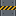 | <a href="https://github.com/pkeppeler/deepcharter/blob/pr-media/looks/a-dusk-company/conduit-from-the-square.jpg?raw=true"></a> | <a id="conduit"></a>**The Conduit**<br>place | An undiggable Company pipe from the ore processor straight down through every layer to the Furnace. The story's first clue. | ✅ Built | [SPEC.md](SPEC.md#surface-and-colony), [ADR 0016](adr/0016-the-colony-is-built-once-in-code-and-the-conduit-is-set-when-its-chunk-loads.md) |
| 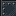 | <a href="https://github.com/pkeppeler/deepcharter/blob/pr-media/looks/a-dusk-company/block-gallery-2.jpg?raw=true"></a> | <a id="colony-kit"></a>**The colony kit**<br>place | 24 Company building blocks (plates, beams, pipes, rails, signs, windows) the town is built from; unbreakable. | ✅ Built | [colony-concepts-2.md](design/colony-concepts-2.md) |
| 📍 | no still yet | <a id="colony-rebuild"></a>**Anchor mode and outposts**<br>place | A Behemoth that unfolds into a temporary outpost; built outposts with beds and storage. | 💭 Idea | [SPEC.md](SPEC.md#outposts-and-ratings) |

### Look and sound

Prosperity at dusk: a rust-red world under a slow dusk, 16 pixel textures drawn from recipes, GeckoLib pods and placeholder sound.

```mermaid
flowchart LR
  n_dusk_sky["⚙️ A dusk sky that never reaches day"]
  n_texture_recipes["⚙️ Textures from recipes"]
  n_placeholder_sound["⚙️ Placeholder sound"]
  n_art_lighting["⚙️ Lighting art"]
  n_salvage_looks["⚙️ Salvage looks"]
  n_public_release["🎯 A public release"]
  classDef built fill:#1f3d2b,stroke:#6fbf73,stroke-width:2px,color:#e8f5e9
  classDef progress fill:#4a3a10,stroke:#f0b429,stroke-width:2px,color:#fff3d6
  classDef planned fill:#2e2e2e,stroke:#9e9e9e,stroke-width:1px,color:#d6d6d6
  classDef idea fill:#1a1a1a,stroke:#757575,stroke-width:1px,stroke-dasharray:4 3,color:#a0a0a0
  classDef ext fill:#ffffff,stroke:#999999,stroke-width:1px,stroke-dasharray:2 2,color:#555555
  class n_dusk_sky,n_texture_recipes,n_placeholder_sound,n_salvage_looks built
  class n_art_lighting planned
  class n_public_release idea
```

| Icon | Still | Feature | What it is | Status | Links |
|---|---|---|---|---|---|
| ⚙️ | <a href="https://github.com/pkeppeler/deepcharter/blob/pr-media/looks/a-dusk-company/sky-cycle.gif?raw=true"></a> | <a id="dusk-sky"></a>**A dusk sky that never reaches day**<br>mechanic | A visual timeline sky swinging between dusk and deep night. | ✅ Built | [ADR 0030](adr/0030-art-direction-decisions.md) |
| ⚙️ | <a href="https://github.com/pkeppeler/deepcharter/blob/pr-media/readme/texture-reference.png?raw=true"></a> | <a id="texture-recipes"></a>**Textures from recipes**<br>mechanic | Every 16 pixel texture is generated from data by tools/textures; no hand-painted files to drift. | ✅ Built | [ADR 0037](adr/0037-texture-layers-are-generated-data-and-casings-connect-through-one-model-type.md) |
| ⚙️ | no still yet | <a id="placeholder-sound"></a>**Placeholder sound**<br>mechanic | 47 sound events, all vanilla stand-ins; a private audio pack carries the original sounds for friends. | ✅ Built | [PLAYING.md](PLAYING.md#private-audio-pack) |
| ⚙️ | no still yet | <a id="art-lighting"></a>**Lighting art**<br>mechanic | Glow accents and beams; see Darkness and sight. | 📋 Planned | [#248](https://github.com/pkeppeler/deepcharter/issues/248) |
| ⚙️ | no still yet | <a id="salvage-looks"></a>**Salvage looks**<br>mechanic | The salvage crate is the freight crate, with the low sled crate as an alternative resource pack; the fungal stalk is the shelf fungus. The other looks are gone. | ✅ Built | [#505](https://github.com/pkeppeler/deepcharter/issues/505), [#472](https://github.com/pkeppeler/deepcharter/issues/472), [#519](https://github.com/pkeppeler/deepcharter/issues/519) |
| 🎯 | no still yet | <a id="public-release"></a>**A public release**<br>goal | A name, a licence and a soundtrack the project may publish; Modrinth, with its AI-content disclosure. | 💭 Idea | [SPEC.md](SPEC.md#18-open-questions) |

## Flows

### Money, fuel and spoil

Ore becomes money at the processor; money becomes parts, fuel and repairs. Rock the drill used to destroy becomes spoil, then slag brick, then new salvage crates.

```mermaid
flowchart TB
  n_ore_in_bay["💎 Ore in the cargo bay"]
  n_sell_ore["⚙️ Sell ore for money"]
  n_spoil["💎 Spoil"]
  n_work_orders["⚙️ Work orders"]
  n_charter_account["💎 The charter's account"]
  n_crate_press["⚙️ Press spoil into salvage crates"]
  n_slag_brick["💎 Slag brick"]
  n_buy_consumables["⚙️ Buy repairs and consumables"]
  n_buy_fuel["⚙️ Buy fuel at the pump"]
  n_buy_parts["⚙️ Buy pod parts"]
  n_catalysts["💎 Catalysts"]
  n_records_board["⚙️ Records board"]
  n_registration_fees["⚙️ Registration fees grow"]
  n_bronzium["Bronzium"]
  n_cicatrium["Cicatrium"]
  n_deepest_point["Deepest point"]
  n_einsteinium["Einsteinium"]
  n_fuel_pump["Fuel pump"]
  n_goldium["Goldium"]
  n_hand_lining["Hand lining"]
  n_heat_shield["Heat shield"]
  n_ironium["Ironium"]
  n_liner_t1["Liner tier 1"]
  n_ore_processor["Ore processor"]
  n_platinium["Platinium"]
  n_repair_station["Repair station"]
  n_salvage_crate["Salvage crates"]
  n_silverium["Silverium"]
  n_spoil_hopper["Spoil hopper"]
  n_upgrade_terminal["Upgrade terminal"]
  n_bronzium == feeds ==> n_ore_in_bay
  n_charter_account == feeds ==> n_buy_consumables
  n_charter_account == feeds ==> n_buy_fuel
  n_charter_account == feeds ==> n_buy_parts
  n_cicatrium == feeds ==> n_catalysts
  n_crate_press == feeds ==> n_salvage_crate
  n_deepest_point --> n_work_orders
  n_einsteinium == feeds ==> n_ore_in_bay
  n_fuel_pump --> n_buy_fuel
  n_goldium == feeds ==> n_ore_in_bay
  n_ironium == feeds ==> n_ore_in_bay
  n_ore_in_bay == feeds ==> n_sell_ore
  n_ore_processor --> n_sell_ore
  n_platinium == feeds ==> n_ore_in_bay
  n_repair_station --> n_buy_consumables
  n_sell_ore == feeds ==> n_charter_account
  n_silverium == feeds ==> n_ore_in_bay
  n_slag_brick == feeds ==> n_hand_lining
  n_slag_brick == feeds ==> n_heat_shield
  n_slag_brick == feeds ==> n_liner_t1
  n_spoil == feeds ==> n_crate_press
  n_spoil == feeds ==> n_slag_brick
  n_spoil_hopper --> n_spoil
  n_upgrade_terminal --> n_buy_parts
  n_work_orders == feeds ==> n_charter_account
  classDef built fill:#1f3d2b,stroke:#6fbf73,stroke-width:2px,color:#e8f5e9
  classDef progress fill:#4a3a10,stroke:#f0b429,stroke-width:2px,color:#fff3d6
  classDef planned fill:#2e2e2e,stroke:#9e9e9e,stroke-width:1px,color:#d6d6d6
  classDef idea fill:#1a1a1a,stroke:#757575,stroke-width:1px,stroke-dasharray:4 3,color:#a0a0a0
  classDef ext fill:#ffffff,stroke:#999999,stroke-width:1px,stroke-dasharray:2 2,color:#555555
  class n_ore_in_bay,n_sell_ore,n_spoil,n_work_orders,n_charter_account,n_crate_press,n_slag_brick,n_buy_consumables,n_buy_fuel,n_buy_parts built
  class n_catalysts planned
  class n_records_board,n_registration_fees idea
  class n_bronzium,n_cicatrium,n_deepest_point,n_einsteinium,n_fuel_pump,n_goldium,n_hand_lining,n_heat_shield,n_ironium,n_liner_t1,n_ore_processor,n_platinium,n_repair_station,n_salvage_crate,n_silverium,n_spoil_hopper,n_upgrade_terminal ext
```

| Icon | Still | Feature | What it is | Status | Links |
|---|---|---|---|---|---|
| 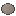 | <a href="https://github.com/pkeppeler/deepcharter/blob/pr-media/readme/ore-cargo.png?raw=true"></a> | <a id="ore-in-bay"></a>**Ore in the cargo bay**<br>resource | Mined ore rides home as heavy items; only our ore counts as cargo. | ✅ Built | [ADR 0008](adr/0008-ore-is-an-item-with-a-mass.md) |
|  | <a href="https://github.com/pkeppeler/deepcharter/blob/pr-media/looks/a-dusk-company/screen-ore-processor-online.jpg?raw=true"></a> | <a id="sell-ore"></a>**Sell ore for money**<br>mechanic | The processor pays a fixed base price per ore. | ✅ Built |  |
|  | no still yet | <a id="spoil"></a>**Spoil**<br>resource | With a spoil hopper the drill keeps one spoil for each block of waste rock; the bay holds 64. | ✅ Built | [mechanics.md](design/mechanics.md#hand-lining-313-a) |
| ⚙️ | <a href="https://github.com/pkeppeler/deepcharter/blob/pr-media/186/work-order-on-the-terminal.png?raw=true"></a> | <a id="work-orders"></a>**Work orders**<br>mechanic | The Company posts orders (deliver 10 bronzium) that pay a bonus and move the story; later ones repeat. | ✅ Built | [SPEC.md](SPEC.md#three-channels), [#186](https://github.com/pkeppeler/deepcharter/issues/186), [#221](https://github.com/pkeppeler/deepcharter/issues/221) |
| 💎 | no still yet | <a id="charter-account"></a>**The charter's account**<br>resource | One shared pot of money for the whole crew. | ✅ Built | [ADR 0007](adr/0007-charters-are-one-versioned-saved-data.md), [SPEC.md](SPEC.md#6-charters) |
|  | <a href="https://github.com/pkeppeler/deepcharter/blob/pr-media/489/processor-after-press.png?raw=true"></a> | <a id="crate-press"></a>**Press spoil into salvage crates**<br>mechanic | The processor presses spoil into new salvage crates, so wood and scrap renew. | ✅ Built | [#470](https://github.com/pkeppeler/deepcharter/issues/470), [#489](https://github.com/pkeppeler/deepcharter/issues/489), [mechanics.md](design/mechanics.md#renewable-salvage-470-a) |
|  | <a href="https://github.com/pkeppeler/deepcharter/blob/pr-media/readme/pod-lining.png?raw=true"></a> | <a id="slag-brick"></a>**Slag brick**<br>resource | The processor fuses 2 spoil into 1 brick for no money; bricks line shafts against lava. | ✅ Built | [mechanics.md](design/mechanics.md#liner-bricks-363-a) |
|  | <a href="https://github.com/pkeppeler/deepcharter/blob/pr-media/readme/repair-station.png?raw=true"></a> | <a id="buy-consumables"></a>**Buy repairs and consumables**<br>mechanic | Hull nanobots, dynamite, explosives, teleport items and a reserve tank at the repair station. | ✅ Built |  |
|  | <a href="https://github.com/pkeppeler/deepcharter/blob/pr-media/readme/fuel-pump.png?raw=true"></a> | <a id="buy-fuel"></a>**Buy fuel at the pump**<br>mechanic | Early fuel is crafted; later it is bought at the fuel pump. | ✅ Built |  |
| 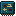 | <a href="https://github.com/pkeppeler/deepcharter/blob/pr-media/readme/upgrade-terminal.png?raw=true"></a> | <a id="buy-parts"></a>**Buy pod parts**<br>mechanic | Tiered parts for drill, hull, engine, tank, radiator, cargo, scanner, lights and more. | ✅ Built | [SPEC.md](SPEC.md#components) |
|  | no still yet | <a id="catalysts"></a>**Catalysts**<br>resource | Every chassis and every couple of tiers also needs a rare material from one layer; Cicatrium is the first. | 📋 Planned | [SPEC.md](SPEC.md#economy) |
| ⚙️ | no still yet | <a id="records-board"></a>**Records board**<br>mechanic | One entry per charter at the colony: deepest breach, wealth hauled, wrecks salvaged. | 💭 Idea | [SPEC.md](SPEC.md#economy) |
| ⚙️ | no still yet | <a id="registration-fees"></a>**Registration fees grow**<br>mechanic | Each extra pod a charter registers costs more, so a free second Mole is no cheap deep miner. | 💭 Idea | [SPEC.md](SPEC.md#getting-more-pods) |

### The ore ladder

Seven ores, cheap to dear. All seven are in layer 1 and below, rarer in the deep zones. Cicatrium is the catalyst, not a sale.

```mermaid
flowchart LR
  n_ironium["💎 Ironium"]
  n_bronzium["💎 Bronzium"]
  n_silverium["💎 Silverium"]
  n_goldium["💎 Goldium"]
  n_platinium["💎 Platinium"]
  n_einsteinium["💎 Einsteinium"]
  n_cicatrium["💎 Cicatrium"]
  n_catalysts["Catalysts"]
  n_ore_in_bay["Ore in the cargo bay"]
  n_bronzium == feeds ==> n_ore_in_bay
  n_bronzium --> n_silverium
  n_cicatrium == feeds ==> n_catalysts
  n_einsteinium --> n_cicatrium
  n_einsteinium == feeds ==> n_ore_in_bay
  n_goldium == feeds ==> n_ore_in_bay
  n_goldium --> n_platinium
  n_ironium --> n_bronzium
  n_ironium == feeds ==> n_ore_in_bay
  n_platinium --> n_einsteinium
  n_platinium == feeds ==> n_ore_in_bay
  n_silverium --> n_goldium
  n_silverium == feeds ==> n_ore_in_bay
  classDef built fill:#1f3d2b,stroke:#6fbf73,stroke-width:2px,color:#e8f5e9
  classDef progress fill:#4a3a10,stroke:#f0b429,stroke-width:2px,color:#fff3d6
  classDef planned fill:#2e2e2e,stroke:#9e9e9e,stroke-width:1px,color:#d6d6d6
  classDef idea fill:#1a1a1a,stroke:#757575,stroke-width:1px,stroke-dasharray:4 3,color:#a0a0a0
  classDef ext fill:#ffffff,stroke:#999999,stroke-width:1px,stroke-dasharray:2 2,color:#555555
  class n_ironium,n_bronzium,n_silverium,n_goldium,n_platinium,n_einsteinium,n_cicatrium built
  class n_catalysts,n_ore_in_bay ext
```

| Icon | Still | Feature | What it is | Status | Links |
|---|---|---|---|---|---|
|  | <a href="https://github.com/pkeppeler/deepcharter/blob/pr-media/looks/a-dusk-company/block-gallery-1.jpg?raw=true"></a> | <a id="ironium"></a>**Ironium**<br>resource | $30 an ore. Many small brown chunks. The baseline. | ✅ Built | [ores.md](design/ores.md) |
|  | <a href="https://github.com/pkeppeler/deepcharter/blob/pr-media/looks/a-dusk-company/block-gallery-1.jpg?raw=true"></a> | <a id="bronzium"></a>**Bronzium**<br>resource | $60 an ore. Two fat orange domes. | ✅ Built | [ores.md](design/ores.md) |
|  | <a href="https://github.com/pkeppeler/deepcharter/blob/pr-media/looks/a-dusk-company/block-gallery-1.jpg?raw=true"></a> | <a id="silverium"></a>**Silverium**<br>resource | $100 an ore. A thin thread with two pale crystals. | ✅ Built | [ores.md](design/ores.md) |
|  | <a href="https://github.com/pkeppeler/deepcharter/blob/pr-media/looks/a-dusk-company/block-gallery-1.jpg?raw=true"></a> | <a id="goldium"></a>**Goldium**<br>resource | $250 an ore. A thread that swells into one bright nugget. | ✅ Built | [ores.md](design/ores.md) |
|  | <a href="https://github.com/pkeppeler/deepcharter/blob/pr-media/looks/a-dusk-company/block-gallery-1.jpg?raw=true"></a> | <a id="platinium"></a>**Platinium**<br>resource | $750 an ore. Two thick lilac-white bars. | ✅ Built | [ores.md](design/ores.md) |
|  | <a href="https://github.com/pkeppeler/deepcharter/blob/pr-media/looks/a-dusk-company/block-gallery-1.jpg?raw=true"></a> | <a id="einsteinium"></a>**Einsteinium**<br>resource | $2000 an ore. Two teal crystals in dark hollows. | ✅ Built | [ores.md](design/ores.md) |
|  | <a href="https://github.com/pkeppeler/deepcharter/blob/pr-media/looks/a-dusk-company/block-gallery-1.jpg?raw=true"></a> | <a id="cicatrium"></a>**Cicatrium**<br>resource | $1500 an ore. A red scar with a wound in it. The catalyst for chassis restores; it is not sold. | ✅ Built | [ores.md](design/ores.md), [mechanics.md](design/mechanics.md#cicatrium-pacing-issue-209) |
