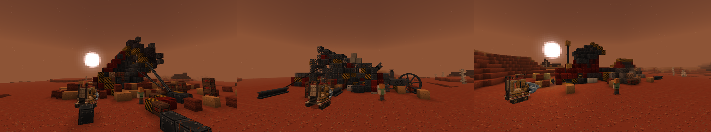
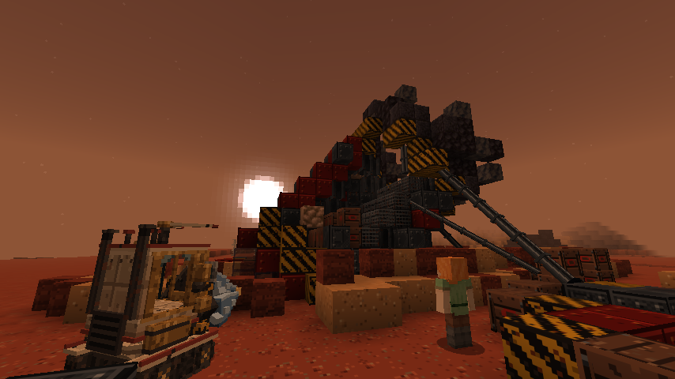
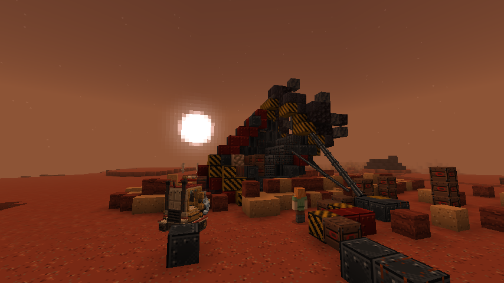
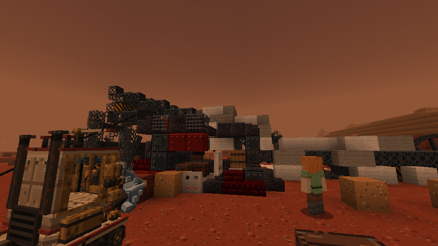
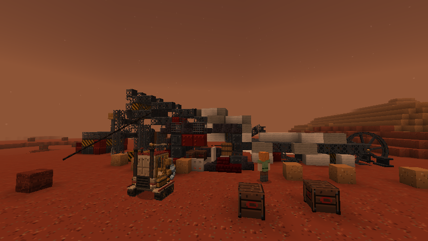
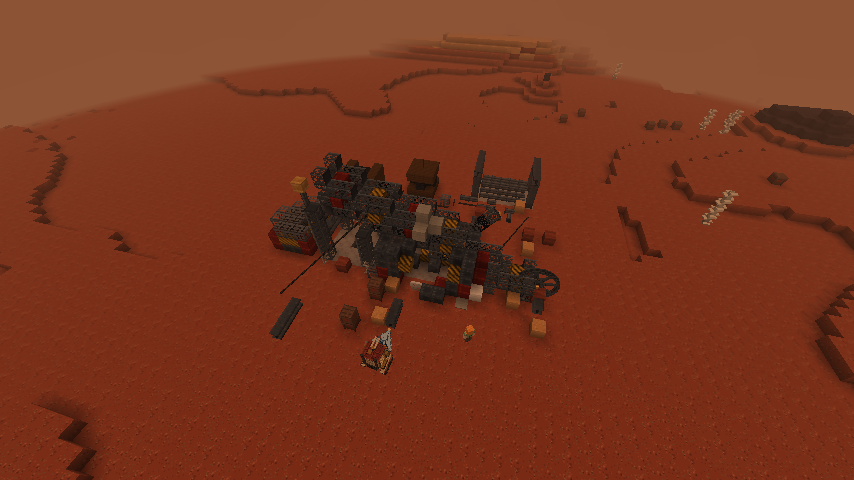
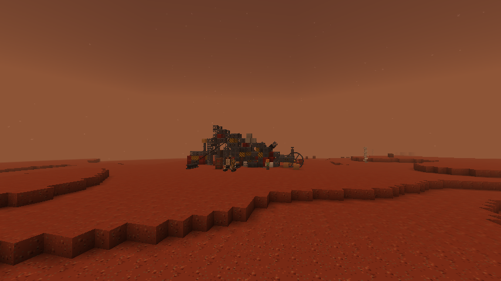

# Wrecked salvage prefabs: three looks

Issue [#1214](https://github.com/pkeppeler/deepcharter/issues/1214), PR [#1215](https://github.com/pkeppeler/deepcharter/pull/1215). A look round for [#471](https://github.com/pkeppeler/deepcharter/issues/471), the wrecked prefabs that give scrap when broken. This round only shows what a wreck could be. How a wreck loots, how often it spawns and how it renews are not decided here: #471 decides them after the pick.

**Picked:** pending.

## What the round is

Three wrecks, each a different kind of machine, so the options differ in shape and structure and not in colour. Each is built from the colony kit and vanilla blocks in the colony's half-scale building language, about 10 to 20 blocks across (a furrow, a track or a spill runs on past that). None reads as a house or a settlement ([SPEC](../SPEC.md#surface-and-colony): the surface has no settlements besides the colony). Salvage crates (the existing `salvage_crate` block) are worked into each, and so is plenty of what reads as scrap: plates, beams, pipe, cable, bars, chain.

Each stands in its real place: the `salvage_yard` biome, in the ring 100 to 160 blocks from the colony's centre, on open ground among the yard's own crates and under its dust haze, at the pinned dusk of the design tour. Every still has a parked pod (the Mole, still the placeholder) and a player standing in it for scale.

| | A. Lander | B. Derrick | C. Train |
|---|---|---|---|
| Kind of wreck | A ship that fell | A tower that fell | A convoy that left the rails |
| What gives it away | A tilted hull, its tail up | A lattice mast lying over a shed | A leaning red engine with a stack |
| Where the scrap is | The hull, torn plates, the legs, the canopy | The mast, the shed's stores, the spools, the pipe rack | The engine, the thrown car, the broken track |
| Where the crates are | In the split bay, spilled down the east flank | In the shed, and out in front of it | In the tipped car's load, and spilled by the cars |

## How to pick

Reply with a letter (**A**, **B** or **C**), or with a mix of named parts, for example "B, but with the train's broken track". The parts you can name:

- **A:** the *hull* (tilted, red spine, split bay), the *furrow* and nose pit, the *legs*, the *canopy*.
- **B:** the *mast* (the lattice and its sheave), the *crushed shed*, the *legs* (the standing stubs), the *spools*, the *pipe rack*, the *winch house*.
- **C:** the *engine* (nose down, heeled over), the *thrown car* with its load, the *tipped car* on the rails, the *broken track*.

Loot, size on the plain and how many a yard holds are open questions for #471, whatever the pick.

## Side by side

The three at mid distance (the mid stills), each in its own spot of the yard:

A fly-around of each, one after the other ([MP4](https://github.com/pkeppeler/deepcharter/blob/pr-media/1215/salvage-prefab-concepts.mp4?raw=true)):

Every still is `<option>-<view>`: `near` (a few blocks past the pod and the player), `mid` (about 15 blocks), `aerial` (22 blocks up) and `range` (about 40 blocks away, at the height of a standing player).

## A. Downed supply lander

A colony drop-ship that came down nose-first. Its nose is in a pit at the end of a long scorched furrow, its tail high on one good leg with the second leg snapped and the third bent under the hull. The hull is split open along its east flank and the cargo bay's deck, ribs and crates show through; more crates have spilled down to the ground. Its canopy lies in rags beside it, in two colours.

- **Reads as:** a vehicle, at every distance. The tilted hull with its red spine, hazard rings and scorched bell is the clearest silhouette of the three, and it is the tallest (about 13 blocks).
- **Weak:** the earth thrown up round the nose is a ring of lumps that reads as a cake of blocks from the air, and the furrow is faint from the side. The hull is dark against the red plain.
- **Salvage:** plates and bell (scrap), crates in the bay and below the split, the canopy cloth.

| Near | Mid |
|---|---|
|  |  |
| **Aerial** | **Range** |
|  |  |

## B. Toppled survey derrick

A prospecting derrick that fell across the tool shed it crushed. Two tall lattice legs and two stumps still stand on the footing; the mast hangs from them, lies over the shed's caved roof, breaks at the middle and ends on the ground with its sheave wheel off its bearings. The shed's walls bulge out under the weight. Torn tarps, a cable spool standing and one lying, paid-out cable, a rack of drill pipe with its pipes slid out, and a winch house with its drum hanging out lie round it.

- **Reads as:** a tower that fell, from near and from the air: the lattice, the red and yellow collars and the sheave say derrick. It has the most parts to loot.
- **Weak:** the busiest of the three. From the side the shed and the mast run together into one dark heap, and the tarps are few after thinning.
- **Salvage:** the mast's girders and collars, the shed's stores and crates, the spools and cable, the pipe.

| Near | Mid |
|---|---|
|  |  |
| **Aerial** | **Range** |
|  |  |

## C. Derailed ore train

A haul engine and two skip cars off a short run of broken track. The engine has left the rails to the east, nose down and heeled over, its nose and two axles in the dirt. The car coupled behind it is thrown on its side with its load, a crate or two among it, spilling out. The next car is still on the rails with its tub tipped over and half its load out. The track ends in bent rails and torn-up sleepers.

- **Reads as:** a leaning engine, from near and from the air (the stack, the cab, the pilot). The track and the cars say "train" only when you see them from above.
- **Weak:** the weakest of the three. At 40 blocks the engine is a red box with a chimney and the cars are rubble, so it can read as a shed. The wheels are hidden from the side the camera takes, and the lean is clearer in the aerial than in any ground still.
- **Salvage:** the engine's plate, the thrown car, the track, the spilled load and its crates.

| Near | Mid |
|---|---|
|  |  |
| **Aerial** | **Range** |
|  |  |

## Where it comes from

`tools/colony/wrecks.py` makes the three pieces from a seeded generator (`--check` is the drift gate, `tools/tests/test_wrecks.py` its tests), in the gametest pack only: `src/gametest/resources/data/deepcharter-test/structure/salvage_prefab_concepts/`, with one layout file beside it that says where each piece's ground is, what stands for scale and where the cameras look. Nothing reaches a player's world. The scenario `salvage-prefab-concepts` finds open ground in the yard, levels it into the plain, places each piece, and shoots it (`tools/record-evidence.sh salvage-prefab-concepts`). #471 moves the winning piece to main data.
