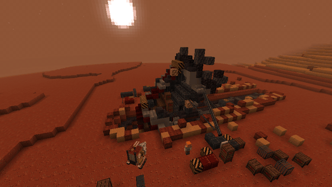
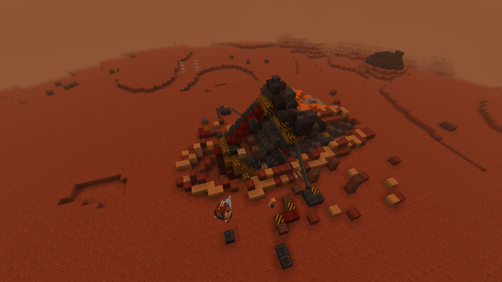
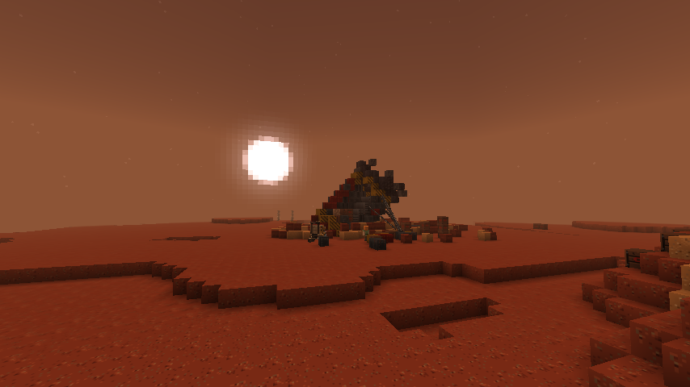
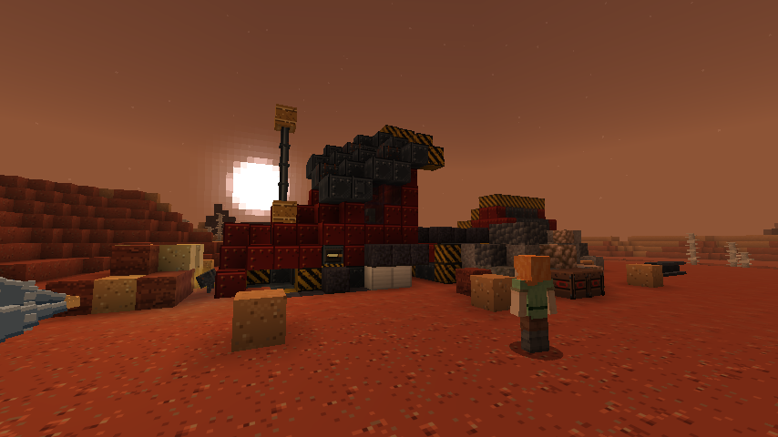
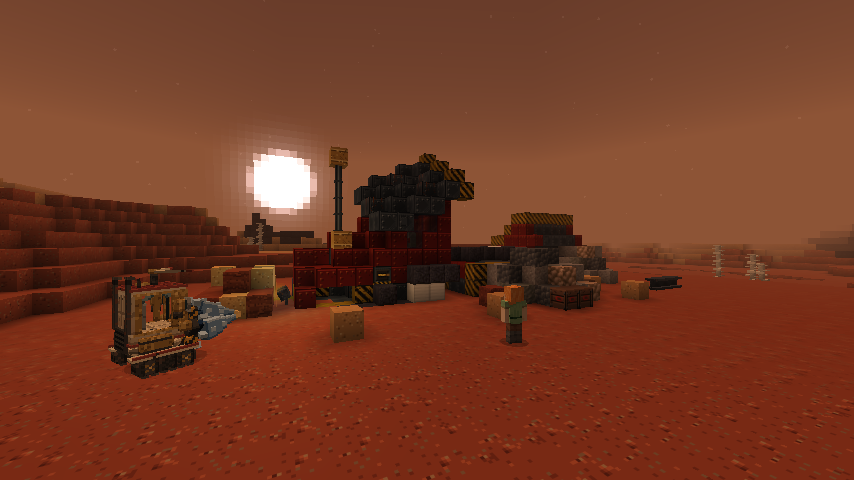
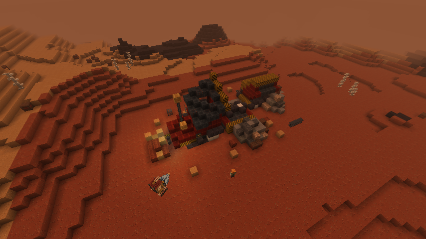
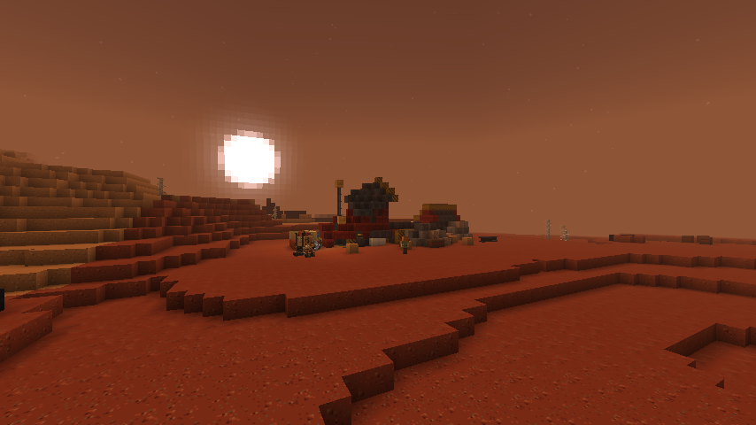

# Wrecked salvage prefabs: three looks

Issue [#1214](https://github.com/pkeppeler/deepcharter/issues/1214), PR [#1215](https://github.com/pkeppeler/deepcharter/pull/1215). A look round for [#471](https://github.com/pkeppeler/deepcharter/issues/471), the wrecked prefabs that give scrap when broken. This round only shows what a wreck could be. How a wreck loots, how often it spawns and how it renews are not decided here: #471 decides them after the pick.

**Picked:** A, with B's mast: the downed lander, with the derrick's fallen lattice mast lying nearby. The user's feedback, verbatim: "they need to look more like the thing they are supposed to look like. I think they're 70% of the way there." That is the bar for the #471 build: the lander must read unmistakably as a crashed lander, and the mast as a derrick mast.

## What the round is

Three wrecks, each a different kind of machine, so the options differ in shape and structure and not in colour. Each is built from the colony kit and vanilla blocks in the colony's half-scale building language, about 10 to 20 blocks across for the lander and the derrick's shed, with a furrow, a mast or a train that runs on much longer. None reads as a house or a settlement ([SPEC](../SPEC.md#surface-and-colony): the surface has no settlements besides the colony). Salvage crates (the existing `salvage_crate` block) are worked into each, and so is plenty of what reads as scrap: plates, beams, pipe, cable, bars, chain.

Each stands in its real place: the `salvage_yard` biome, in the ring 100 to 160 blocks from the colony's centre, on open ground among the yard's own crates and under its dust haze, at the pinned dusk of the design tour. Every still has a parked pod (the Mole, still the placeholder) and a player standing in it for scale.

| | A. Lander | B. Derrick | C. Train |
|---|---|---|---|
| Kind of wreck | A ship that fell | A tower that fell | A convoy that left the rails |
| What gives it away | A tilted hull, its tail up | A long lattice mast lying past a shed | A long train on a curve of track, its engine thrown off |
| Where the scrap is | The hull, torn plates, the legs, the canopy | The mast, the shed's stores, the spools, the pipe rack | The engine, the thrown car, the broken track |
| Where the crates are | In the split bay, spilled down the east flank | In the shed, and out in front of it | In the tipped car's load, and spilled by the cars |

## How to pick

Reply with a letter (**A**, **B** or **C**), or with a mix of named parts, for example "B, but with the train's broken track". The parts you can name:

- **A:** the *hull* (tilted, red spine, pale panels, split bay), the *furrow* and nose pit, the *legs*, the *canopy*.
- **B:** the *mast* (the lattice and its sheave), the *stove-in shed*, the *legs* (the standing stubs), the *spools*, the *pipe rack*, the *winch house*.
- **C:** the *engine* (boiler, dome, stack, wheels), the *thrown car* with its load, the *tipped car* on the rails, the *crate car*, the *broken track*.

Loot, size on the plain and how many a yard holds are open questions for #471, whatever the pick.

## Side by side

The three at mid distance (the mid stills), each in its own spot of the yard:

A fly-around of each, one after the other ([MP4](https://github.com/pkeppeler/deepcharter/blob/pr-media/1215/salvage-prefab-concepts.mp4?raw=true)):

Every still is `<option>-<view>`: `near` (a few blocks past the pod and the player), `mid` (about 15 blocks), `aerial` (22 blocks up) and `range` (about 40 blocks away, at the height of a standing player).

## A. Downed supply lander

A colony drop-ship that came down nose-first. Its nose is in a scorched pit at the end of a long furrow (a trench about 40 blocks long, widening and deepening toward the impact, with berms along its sides), its tail high on one good leg with the second leg snapped and the third bent under the hull. The hull is split open along its east flank and the cargo bay's deck, ribs and crates show through; more crates have spilled down to the ground. Its canopy lies in rags beside it, in two colours, and chains and a hatch flap hang off the torn tail. Panels and bands of pale plate break up the dark hull, and its outline is cut with stairs and slabs.

- **Reads as:** a vehicle, at every distance. The tilted hull with its red spine, pale panels and scorched bell is the clearest silhouette of the three, and the tallest (about 13 blocks).
- **Weak:** it is still the darkest mass on the plain, and the stair cuts leave a few ragged corners where two edges meet.
- **Salvage:** plates and bell (scrap), crates in the bay and below the split, the canopy cloth.

| Near | Mid |
|---|---|
|  |  |
| **Aerial** | **Range** |
|  |  |

## B. Toppled survey derrick

A prospecting derrick that fell across a tool shed. Two tall lattice legs and two stumps still stand on the footing; the mast hangs from them, clips the shed's north edge and runs on, about 27 blocks in all, to break in two and end on the ground with its sheave wheel off its bearings. The shed stands apart in front of it, stove in on the mast side, its roof and walls holed. Torn tarps lie over the mast, the shed's roof and the ground, with chains swinging under them; a cable spool stands and another lies, with cable paid out, beside a rack of drill pipe with its pipes slid out and a winch house with its drum hanging out.

- **Reads as:** a tower that fell. From the side, and from 40 blocks, the mast is one long line from the legs to the sheave, with the shed clear of it. It has the most parts to loot.
- **Weak:** the shed, seen close from the front, still reads as a small building before it reads as a wreck, and the lattice is dark against the plain.
- **Salvage:** the mast's girders and collars, the shed's stores and crates, the spools and cable, the pipe.

| Near | Mid |
|---|---|
|  |  |
| **Aerial** | **Range** |
|  |  |

## C. Derailed ore train

A long train along a curve of buckled track, about 50 blocks from the last car to the engine's nose. The last car is still on the rails with salvage crates in its tub; the next has its tub tipped over its edge, spilling ore; the one behind the engine is thrown on its side with its load out. The engine, a horizontal red boiler with brass bands, a dome and a stack, a cab at the back and three pairs of wheels with pale hubs, is thrown off the end of the rails, nose down. The rails end in bent bars and chains; lengths of rail lie flung clear.

- **Reads as:** a train from the air: the boiler, the dome, the stack and the wheels read as an engine, and the strung-out cars say train. It is not a house: there is no box with a roof and a chimney in it.
- **Weak:** the weakest of the three, and I stopped at the cap. At ground level the engine and the cars read as heaps of red and black blocks, and the long boiler is lost in the weathering. The rails are barely visible in the stills, so the curve does not read. The wheels show only from above.
- **Salvage:** the engine's plate, the cars, the spilled ore, the crates in the rear car and on the ground.

| Near | Mid |
|---|---|
|  |  |
| **Aerial** | **Range** |
|  |  |

## Where it comes from

`tools/colony/wrecks.py` makes the three pieces from a seeded generator (`--check` is the drift gate, `tools/tests/test_wrecks.py` its tests), in the gametest pack only: `src/gametest/resources/data/deepcharter-test/structure/salvage_prefab_concepts/`, with one layout file beside it that says where each piece's ground is, what stands for scale and where the cameras look. Nothing reaches a player's world. The scenario `salvage-prefab-concepts` finds open ground in the yard, levels it into the plain, places each piece, and shoots it (`tools/record-evidence.sh salvage-prefab-concepts`). #471 moves the winning piece to main data.
